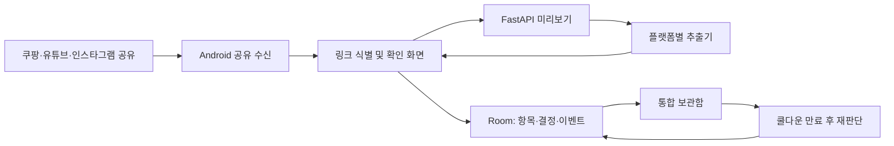

# 랄프톤 MVP 개발 가이드

> **최신 v2:** 스크린샷 추가와 직접 입력이 핵심이다. 링크 파싱은 미지원 틀만, 이미지 API는 문서 제공 전 미연결 틀만 준비한다. 빨강 기반 라이트·다크·시스템 테마와 반응형·모션을 포함한 현재 범위는 [GOAL_SPEC.md](./GOAL_SPEC.md)와 [todo.md](./todo.md)를 따른다. 아래 기술 스택/연계 계획은 초기 구상이며 현재 구현 상태가 아니다.

> **2026-09-29 범위 변경:** 이 문서는 초기 3개 플랫폼 구상이다. 현재는 **쿠팡 전용**, 인스타그램 보류, 유튜브 제외다. 실행 우선순위는 [GOAL_SPEC.md](./GOAL_SPEC.md) → [todo.md](./todo.md)를 따른다. 실제 구현/검증 상태는 [CHECKPOINT.md](./CHECKPOINT.md), 쿠팡 실페이지 조사는 [COUPANG_PARSING_TECHNICAL.md](./COUPANG_PARSING_TECHNICAL.md)에 정리했다. 현재 저장소는 SharedPreferences JSON을 사용하며 아래 Room/FastAPI 제안은 구현된 상태가 아니다.

> 기준 문서: [랄프톤 제품 브리프 v4](<./ralphthon-product-brief-b58jYyjbQYHVtRNKNPE6hpmB-20260926-v4 (1).md>)  
> 작성일: 2026-09-29  
> 구현 전제: 해커톤 시연 기기는 Android 휴대폰 1대 이상. iOS 동시 출시가 필수라면 공유 확장 기능의 일정과 구현 방식을 별도로 결정한다.

플랫폼 API의 자격 증명·허용 범위·미확인 사항은 [API 사전 조사](./API_PREREQUISITES.md)를 따른다.

## 1. 이번에 완성할 사용자 경험

1. 쿠팡 상품, 유튜브 영상, 인스타그램 게시물에서 **공유하기 → 랄프톤**을 선택한다.
2. 앱이 전달받은 링크를 식별하고 확보 가능한 제목·이미지·설명·가격을 채운다.
3. 사용자가 실제로 사고 싶은 **상품명과 가격**을 확인·수정하고 쿨다운 시간을 선택해 저장한다.
4. 세 플랫폼의 항목이 한 보관함에 표시된다. 쿨다운 만료 후 구매 또는 포기를 결정한다.
5. 결정 이력이 남고, 포기한 항목의 확정 가격이 중복 없이 합산된다.

사용자가 상품을 확인하기 전의 항목은 `draft`로 취급한다. 자동 추출에 실패해도 링크와 플랫폼을 보여 주고 같은 확인 화면에서 저장을 마칠 수 있어야 한다. 브리프의 시연 범위에는 세 플랫폼의 공유 수신과 재판단 흐름이 모두 포함된다.

## 2. 권장 기술 스택

| 영역 | 선택 | 이 프로젝트에서 맡는 역할 |
| --- | --- | --- |
| Android 앱 | Kotlin, Jetpack Compose, Material 3 | 공유 수신, 확인 화면, 보관함, 결정 이력 |
| 공유 진입점 | Android `ACTION_SEND`, `text/plain` | 외부 앱이 보낸 링크·텍스트 수신. [Android 공식 가이드](https://developer.android.com/develop/ui/compose/sharing/receive) |
| 앱 상태 | ViewModel, Kotlin Coroutines, StateFlow | 추출 중·실패·저장 완료 상태와 화면 갱신 |
| 영속 저장 | Room(SQLite) | 항목·결정·측정 이벤트를 기기에 저장. [Room 공식 가이드](https://developer.android.com/training/data-storage/room) |
| 앱 네트워크 | Retrofit + OkHttp | 미리보기 API 호출, 시간 제한과 오류 처리 |
| 링크 추출 서버 | Python, FastAPI, Pydantic, HTTPX, Beautiful Soup | 플랫폼별 어댑터, 공개 메타데이터 파싱, 통일된 JSON 응답. [FastAPI 공식 가이드](https://fastapi.tiangolo.com/tutorial/) |
| 유튜브 정보 | YouTube Data API `videos.list(part=snippet)` | 제목·설명·썸네일. [공식 API](https://developers.google.com/youtube/v3/docs/videos/list) |
| 알림 | Android WorkManager, 선택 사항 | 만료 후 재방문 알림. 실행 시각의 정확성을 상태 판정에 사용하지 않는다. [WorkManager 문서](https://developer.android.com/reference/androidx/work/WorkManager) |
| 검증 | JUnit/Compose UI 테스트, pytest/FastAPI TestClient, 실기기 공유 테스트 | 상태 전이, 추출기, 실제 플랫폼 공유 흐름 검증. [FastAPI 테스트 가이드](https://fastapi.tiangolo.com/tutorial/testing/) |
| 빌드·의존성 | Gradle Version Catalog, Python `uv.lock` | 팀원 간 동일한 의존성 버전 재현 |

**서버는 링크 미리보기만 담당한다.** 해커톤 버전의 사용자 항목과 결정 기록은 앱의 Room에 저장한다. 계정, 동기화 DB, 결제 서버는 이번 흐름에 필요하지 않다. API 키가 필요한 호출은 서버에서 수행하고 키를 APK에 넣지 않는다. 시연용 서버는 HTTPS로 접근 가능한 환경에 배포하며, 배포 주소와 키는 빌드 설정·환경 변수로 주입한다.

## 3. 구성과 책임



- 앱은 공유 텍스트에서 URL을 추출하고, 원문과 원본 URL을 보존한다. 같은 URL 재공유 시 기존 항목을 보여 주어 중복 저장을 피한다.
- 서버는 `YouTubeExtractor`, `CoupangExtractor`, `InstagramExtractor`처럼 플랫폼별 코드를 분리한다. 응답 필드는 같고 값이 없으면 `null`을 보낸다.
- 서버가 실패하거나 네트워크가 끊겨도 앱의 확인 화면은 계속 열린다. 사용자는 링크를 보관하고 필요한 필드를 보완할 수 있다.
- 쿨다운 상태는 저장한 만료 시각과 현재 시각으로 계산한다. 알림이 늦거나 꺼져 있어도 항목은 만료된 상태로 표시된다.

### 미리보기 API 계약

`POST /v1/previews` 입력은 `{ "sharedText": "..." }`로 시작한다. 성공 응답의 최소 형식은 다음과 같다.

```json
{
  "platform": "youtube",
  "originalUrl": "https://www.youtube.com/watch?v=VIDEO_ID",
  "canonicalUrl": "https://www.youtube.com/watch?v=VIDEO_ID",
  "sourceTitle": "영상 제목",
  "description": "영상 설명",
  "thumbnailUrl": "https://...",
  "suggestedProductName": null,
  "priceWon": null,
  "extractionStatus": "partial",
  "fetchedAt": "2026-09-29T00:00:00Z"
}
```

`extractionStatus`는 `complete`, `partial`, `link_only` 중 하나다. 지원하지 않는 링크는 별도 `unsupported` 오류로 반환한다. 앱은 `partial`과 `link_only`도 정상적인 확인 화면으로 연결한다. 미리보기 서버는 항목 저장이나 구매 결정을 처리하지 않는다.

## 4. 플랫폼별 추출 범위와 선행 실험

코딩을 시작하기 전에 각 플랫폼의 **실제 앱에서 공유한 링크 5개 이상**을 확보한다. 공개 게시물, 단축 링크, 가격 옵션이 있는 상품 등 서로 다른 사례를 포함한다. 공유 텍스트와 서버에서 합법적으로 확보 가능한 필드를 표로 기록한 뒤 시연 링크를 고른다.

| 플랫폼 | 1차 구현 | 실패했을 때의 흐름 | 주의할 점 |
| --- | --- | --- | --- |
| 쿠팡 | 공유 URL과 앱이 보낸 텍스트 확보. 공개 메타데이터 추출은 실측·허용 범위 확인 후 추가 | URL을 유지하고 상품명·가격 확인/입력 | 공식 Open API는 판매자·연동사 업무 중심이므로 임의 소비자 상품의 가격 조회 수단으로 전제하지 않는다. [쿠팡 개발자 센터](https://developers.coupang.com/en) |
| 유튜브 | 영상 ID를 추출해 공식 API로 제목·설명·썸네일 조회 | URL·공유 텍스트 표시, 구매 대상 상품명·가격 입력 | 영상 제목은 구매 상품명이 아니다. 임의의 공개 영상 자막 다운로드는 공식 API에서 허용되지 않는다. API에서 가져온 메타데이터는 30일 내 갱신 또는 삭제한다. [자막 API](https://developers.google.com/youtube/v3/docs/captions/download), [데이터 보관 정책](https://developers.google.com/youtube/terms/developer-policies) |
| 인스타그램 | 공유 URL과 앱이 보낸 텍스트 확보 | URL을 유지하고 상품명·가격 확인/입력 | 공식 oEmbed는 임베드 화면 용도이며 응답 메타데이터를 상품 데이터로 추출·저장할 수 없다. 썸네일·캡션 자동 입력을 확정 기능으로 두지 않는다. [Meta 공식 제한](https://developers.facebook.com/documentation/instagram-platform/oembed) |

가격이 추출되어도 사용자가 저장 시점에 확인한다. 금액은 **원 단위 정수**로 저장하고, 추출 시각도 함께 보관한다. 유튜브·인스타그램 콘텐츠 속 상품을 자동으로 찾아내는 AI 기능은 브리프의 이번 범위에 없다.

서버가 외부 URL에 접속할 때는 세 플랫폼의 허용 도메인만 받고, 리다이렉트 뒤의 호스트도 검사한다. 사설 IP·로컬 주소를 차단하고 요청 시간·응답 크기를 제한한다. HTML 분석은 공개 메타데이터와 허용된 API 범위에서 수행한다.

## 5. 앱 데이터와 상태 규칙

### 최소 데이터

| 테이블 | 주요 필드 |
| --- | --- |
| `items` | `id`, `platform`, `original_url`, `canonical_url`, `shared_text`, `source_title`, `product_name`, `price_won`(nullable), `thumbnail_url`, `description`, `fetched_at`, `created_at`, `cooldown_until`, `status` |
| `decisions` | `id`, `item_id`(고유), `choice`(`buy`/`skip`), `decided_at`, `price_won_at_decision`(nullable) |
| `events` | `id`, `item_id`(nullable), `platform`, `event_name`, `occurred_at` |

`draft`는 확인 화면의 임시 상태다. 최종 저장 시 `pending`이 되고, 현재 시각이 `cooldown_until`에 도달하면 화면에서 `ready`로 계산한다. 사용자가 선택하면 `decided_buy` 또는 `decided_skip`으로 확정한다. 브리프에 맞춰 사용자가 쿨다운 중 원본 링크로 이동할 수 있게 하고, 조기 구매를 결정하면 그 시점의 결정으로 기록한다.

포기 금액은 `skip` 결정의 `price_won_at_decision`을 합산한다. 가격 미입력 항목은 합계에서 제외하고 건수를 따로 보여 준다. 이 값의 화면 명칭은 **구매를 포기한 금액**으로 둔다. 실제 계좌 잔액이 늘어난 금액으로 해석하지 않는다. 결정 저장과 상태 갱신은 한 DB 트랜잭션으로 처리해 반복 탭으로 합계가 두 번 늘지 않게 한다.

## 6. 개발 순서와 완료 조건

| 순서 | 작업 | 확인할 결과 |
| --- | --- | --- |
| 0. 링크 실측 | 세 앱의 공유 텍스트·추출 가능 필드 조사, 시연 링크 선정 | 플랫폼별 성공·실패 사례표와 시연용 링크 확보 |
| 1. 세로 흐름 | Android 공유 수신 → 확인 → Room 저장 → 보관함 → 30초 테스트 쿨다운 → 결정 | 한 플랫폼에서 앱 종료·재실행 후에도 전 과정 작동 |
| 2. 추출 서버 | 공통 API와 플랫폼별 추출기, `partial`/`link_only` 응답 | 세 플랫폼 링크가 각각 확인 화면에 도착 |
| 3. 사용성 | 수정 가능한 상품명·가격, 로딩·오류·중복 처리, 원본으로 이동 | 추출 실패나 오프라인에서도 저장 가능 |
| 4. 기록·시연 | 포기 금액, 이력, 최소 이벤트, 세 플랫폼 실기기 시연 | 보관함에 세 출처가 함께 보이고 만료 후 결정 가능 |

시연을 위해 만료 시각을 짧게 설정하는 **개발 빌드 옵션**을 둔다. 시연 데이터나 응답을 실제 추출 결과처럼 표시하지 않는다. 테스트에서는 정상 링크뿐 아니라 잘못된 링크, 비공개 게시물, 가격 누락, 중복 공유, 네트워크 장애, 앱 재실행을 확인한다.

## 7. 제품 가설 측정

이벤트는 `share_received`, `preview_completed`, `item_saved`, `cooldown_reopened`, `decision_buy`, `decision_skip` 정도로 시작한다. 플랫폼별 등록 완료율은 `item_saved / share_received`, 재판단 완료율은 `decision_* / 만료 항목 수`로 계산한다. 사용자가 나중에 다시 열었는지, 두 번째 항목을 저장했는지도 기록한다. 해커톤에서는 기기 내 이벤트를 내보내고 사용자 인터뷰를 함께 진행할 수 있다. 여러 사용자에 대한 자동 집계는 동의·계정·서버 저장 정책을 정한 뒤 추가한다.

## 8. 이번 구현의 범위

이번 단계의 개발 대상은 공유 수집, 기본 정보 추출, 사용자 확인, 통합 보관함, 쿨다운, 구매·포기 결정, 금액 합계와 이력이다. 다른 플랫폼, 콘텐츠 속 상품 AI 식별, 가격 비교, 결제, 제휴, 고급 분석, 유료 기능은 브리프의 후속 단계에 둔다.

의사 결정이 필요한 항목은 **시연 대상 OS**, **실제 테스트 기기**, **사용 가능한 YouTube API 프로젝트**, **서버 배포 환경**이다. 위 가이드는 Android 우선과 HTTPS 미리보기 서버를 기본값으로 잡았다.
