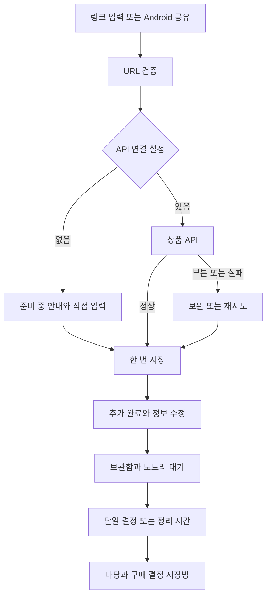

# 하루만 — 구현 목표와 완료 기준

개정일: 2026-09-29 · **v3.2: 링크 API + 모아·토리 통합**

추가 반영: **13:43 KST 수령한 [저장 데이터 시각화](./md_plus/storage-visualization.md)**. 원문은 `draft`지만 새 문서를 적용하라는 사용자 지시에 따라 마당·볼주머니·소비 목표·기간 리포트를 현재 개발 범위에 포함한다. 내용 SHA-256: `A9AEDB110BF812A52EF0C1A26EDFAD529F3E27668118FABF625FE72D42131176`. 기존 검수 결과가 새 화면까지 검증한 것은 아니다.

상태: **RC2 프리릴리스 배포·다운로드·기기 설정 복원 완료, 제한 사항을 명시한 문서 인계 진행 중**

작업 시간: **12:04:47–15:04:47 KST, 180분**

사용자의 “지금부터 작업 시작” 지시가 앞선 문서 전용 제한을 대체했다. API 계약 초안 두 개와 12:19 KST에 받은 [모아·토리 요구사항](./md_plus/mascot-duo/implementation-requirements.md)·가이드·18개 Android 벡터를 현재 구현에 반영한다. `캐릭터 MD 대기`, `설계만 작성`, `구현 재개 대기`는 이전 체크포인트의 상태다.

**현재 확인 범위 —14:43 KST:** JVM **62개**, 실제 Android13 폰 격리 테스트 **63개**, OS모션0의 실제 Choreographer 검사 별도1개 통과를 확인했다. 최종 소스는 `d6fa562349905764d60c0924d505a4eb8b1b91f7`, RC2/code3 APK SHA-256은 `3e136b7a876f0868bb0fb69dcdf1b2bcf3e28a1ed059fc2b2c9ddfd0672a0a90`다. 정확한 파일의 API36 emulator 설치·입력/편집·SKIP·cold 재실행·3모드·선택 폭/글꼴/짧은 창을 확인했고,14:38 [v1.1.0-rc.2 프리릴리스](https://github.com/udonsari0101/Kakao_Ralphthon/releases/tag/v1.1.0-rc.2) 발행과5assets 다운로드·체크섬 일치를 확인했다. 최종 실폰/emulator 설정 복원도14:43 확인했다. 실제 API 미연결, 시스템 공유 직접 검수 차단, 전용 삽질/물주기 미적용, 실제 기간 전환/회전 미검수 등은 남아 있다. 문서 main push는 대기 중이며 모든 요구의 완성을 주장하지 않는다. 상세 근거는 [QA_REPORT](./QA_REPORT.md)와 [todo](./todo.md)를 따른다.

## 1. 이번 목표

상품 링크 또는 직접 입력으로 상품을 담고, 모아와 토리의 안내를 따라 기다린 뒤 한 번 더 생각해 결정하는 Android 앱을 완성한다. 링크 응답에 문제가 있으면 수정할 수 있고, 실제 데이터·상태와 다른 성공이나 금액을 표시하지 않는다.

2026-09-29 추가 지시: 온보딩·입력창·공유 안내·오류·상품 출처 등 사용자 노출 문구는 **상품 링크**로 통일한다. 특정 쇼핑몰 이름을 안내 문구에 넣지 않는다. 서버 식별자와 지원 URL 계약은 기술 문서에서 별도로 관리한다.

| 범위 | 현재 목표·구현 원칙 |
| --- | --- |
| 링크 입력·공유 | 앱 내 `링크로 추가`, Android `ACTION_SEND text/plain` 양쪽이 같은 요청 흐름 사용 |
| 지정 API | `POST /v1/products/extract`, 요청 body의 `url`; 실제 주소·인증 수령 후 연결 |
| 응답 처리 | 유효한 `success`는 한 번 자동 저장, `partial`은 보완, 오류는 재시도/직접 입력 |
| 수동 입력·편집 | 이름·선택 가격·설명·메모·갖고 싶은 정도, 이미지 숨기기; 원본 링크 보존 |
| 보관·판단 | 시간 선택, 흙더미→결정할 때 새싹, 단일 결정, 준비된 상품의 정리 시간 |
| 마당·소비 목표 | 주/월 날짜 마당, 볼 5단계, 선택 목표·구매 결정 목록, 기간 리포트; 아래 4.1절 기준 |
| 캐릭터 | 햄스터 **모아**는 담기, 다람쥐 **토리**는 기다리기·정리·결과 |
| 테마 | 빨강 브랜드, 라이트·다크·시스템, 캐릭터 말풍선/움직임 설정 |
| 품질·배포 | 연결 폰 반복 검수, todo 실시간 갱신, main 체크포인트, 버전별 서명 release APK |

### 현재 범위에서 제외한 것

- 스크린샷 선택·이미지 공유 수신·사용자 이미지 업로드·이미지 분석 API.
- 앱 내부 상품 페이지 HTML/DOM/WebView 파싱과 단축 링크 직접 확장.
- 인스타그램 신규 등록 서비스와 유튜브. 이전 인스타그램 기록의 읽기 호환은 보존한다.
- 새 서버/Mac 수집 환경 구축, 실제 상품 구매·결제.
- mascot-duo의 P2 알림·결과 이미지 공유·별도 마일스톤 배지를 필수 범위로 확대하지 않는다. 정리 결과 **텍스트 공유**는 포함한다.

가이드의 인스타그램 시연, 스크린샷 추가 예정, 파랑 고정 테마, 캐릭터 반말은 최신 사용자 지시에 따라 상품 링크/직접 입력·이미지 입력 제외·빨강 3모드·**전부 해요체**로 조정한다. QA용 화면 캡처·녹화는 상품 입력 기능과 별개다.

## 2. 기능 흐름과 보존 규칙

- 입력할 때마다 요청하지 않고 명시적 버튼 또는 공유 이벤트로 시작한다. 클립보드 배경 감시는 없다.
- 정상 단일 공유는 링크를 다시 입력하게 하지 않는다. 여러 링크는 하나를 선택하고, 작성 중인 초안과 새 공유는 보존·전환 경로를 제공한다.
- 회전·테마 전환·프로세스 복원에서 공유 Intent나 POST를 자동 재실행하지 않는다. 중단된 요청은 복원된 초안에서 재시도한다.
- 요청 취소·화면 닫기·수동 전환·URL 교체 이후 늦은 응답은 저장이나 편집값 덮어쓰기를 만들지 않는다.
- 동일 요청 저장은 acquisition ID로 한 번만 수행한다. 기존 보류 링크의 중복은 해당 상품으로 안내한다.
- 저장 성공 후에만 `추가했어요`와 모아의 받기 효과를 표시한다. API 성공과 로컬 저장 실패를 구분한다.
- 기본 대기 시간은 요청 시작 시 캡처하고, 실제 저장 시점부터 계산한다. 추가 시 0/3/24/72/168시간을 선택한다. 저장 후 별도 날짜 편집은 현재 제공하지 않으며, 준비된 상품은 `조금 더`로 연장한다.
- 목록 항목은 상세로 열어 대기 종료 상품도 정보를 수정할 수 있다. 상세의 `결정하기` 또는 `정리 시간 시작`으로 판단한다.

## 3. API 계약과 현재 연결 상태

계약 입력은 [HARUMAN_API_RESPONSE_SPEC](./HARUMAN_API_RESPONSE_SPEC.md)와 [HARUMAN_PRODUCT_API_PLAN](./HARUMAN_PRODUCT_API_PLAN.md), 상세 매핑은 [LINK_API_DESIGN](./LINK_API_DESIGN.md)을 따른다.

| 구분 | 현재 상태 |
| --- | --- |
| 요청·응답 계약 | URL 요청, success/partial/error, 상품명·원화 가격·이미지·옵션·가격 조건 adapter 작성 |
| 앱 서비스 | `NotConfiguredProductLinkService` 기본, 명시 구성용 `HttpsProductLinkService` 작성 |
| 실제 연결 | base URL·인증·서버 실응답 미제공, 임의 값이나 가짜 성공을 넣지 않음 |
| 설명 | 현재 초안에 description 필드 없음. 직접 입력·수정만 제공하며 옵션/가격 조건을 설명으로 대신 저장하지 않음 |
| 추가 확인 | 인증/오류 계약, 실측 timeout·취소·retry·rate limit, 긴/단축 링크 실제 응답 |

미설정일 때 로딩이나 자동 성공을 꾸미지 않고 `링크로 불러오는 기능은 준비 중이에요`와 직접 입력을 제공한다. 계약 fixture 테스트 통과는 실제 서버 연동 성공을 뜻하지 않는다. API 연결을 받으면 두 진입 경로의 요청 URL → 응답 → 저장/보완 결과를 비밀값 없이 검증한다.

## 4. 데이터·수정·통계

- `haruman_local_v1`을 유지하며 구버전 레코드를 읽는다. 기존 사용자 기록과 예시 데이터를 임의 초기화하지 않는다. 새 설치는 빈 보관함으로 시작한다.
- `WishItem`은 입력 출처, 설명·메모, 이미지 URL/숨김, 요청 식별자, API 스냅샷, 결정 가격, `isSample`, 선택값 `Desire`를 구분한다.
- `Desire.FIRE/LIKE/MEH`는 선택 사항이다. 없음·구버전·모르는 값은 null로 읽는다.
- 금액 미상 null과 명시적인 0원을 구분한다. 결정할 때 `decisionPriceWon`을 고정하고 이후 상품 가격 편집으로 과거 합계를 바꾸지 않는다.
- 예시 상품은 목록에서 구별하고 실제 금액·개수·절약 숲 실적에서 제외한다. 가격 미상 상품은 결정 개수와 나무에는 포함할 수 있지만 금액 합계에서는 제외한다.
- API 원본 값과 사용자 확정값을 분리한다. 잘못된 이미지는 숨길 수 있고 이미지 다운로드 실패가 상품을 다시 저장하거나 필드를 변경하지 않는다.
- `option_label`, `price_type`, `price_note`는 상세의 **가져온 상품 조건**에 따로 표시한다. 실제 주문·결제 완료라고 표현하지 않는다.

### 4.1. 13:43 추가 범위: 볼주머니·도토리 마당·저장방

| 항목 | 확정 기본값·데이터 계약 |
| --- | --- |
| 마당 주기 | `YardPeriod.MONTH` 기본, `WEEK` 선택. 주는 월요일 00:00, 달은 1일 00:00, 기기 시간대의 시작 포함/끝 제외 |
| 날짜 칸 | 상품의 `createdAt` 날짜에 고정. 결정해도 날짜 칸을 옮기지 않음. 같은 날 `createdAt`→ID 순서 |
| 상태 | 대기 중 PENDING=흙더미, `ready(now)`인 PENDING=새싹, SKIP=나무, BUY=파인 구덩이. 연장은 다시 흙더미 |
| 볼주머니 | PENDING 개수 0 / 1–2 / 3–5 / 6–9 / 10+의 5단계. 예시 수량은 별도 안내 |
| 마당 집계 | **이 기간에 담은 상품** 기준. 예시 그림에는 예시 표식을 붙이고 실제 개수·금액·성과에서는 제외 |
| 소비 목표 | 기본 없음. 선택값은 1원 이상 `InputLimits.PRICE_WON` 이하의 정수, 비우면 해제. 주기와 목표를 한 번에 저장 |
| 목표 집계 | 해당 기간 `decidedAt`의 실제 BUY만 합산. **이번 주/달 구매 결정**이라고 명시하며 실제 결제·카드 지출과 구분 |
| 금액 | `decisionPriceWon` 사용. null은 금액 미정, 0원은 알려진 값. 합계 오버플로를 막고 미정 개수를 별도 표시 |
| 표시 이력 | 목표 반응은 주기+기간 시작+구간별, 리포트는 주기+기간 시작별로 각각 보존. 앱 재시작으로 반복하지 않음 |

기록 탭을 **마당**으로 바꾸고 기존 합계·목록은 기간 요약과 전체/나무/구덩이/고민 중 필터로 보존한다. 첫 상품 기간부터 현재까지만 탐색하고 이전/다음·현재 기간 버튼을 둔다. 주기를 바꾸면 현재 기간으로 이동하며 상품 데이터는 바꾸지 않는다. 칸에는 최대 3개와 `+N`, 오늘 테두리, 날짜별 목록을 제공한다. 준비된 새싹은 결정으로, 나무·구덩이는 상세로 연결한다.

나무 크기는 결정 가격 5만 원 미만/5만–20만 원 미만/20만 원 이상이며 미상은 작은 나무+`?`다. 목표가 없으면 게이지를 숨기고 목표가 있으면 70%/90%/100% 경계와 초과를 안내한다. 정확히 100%는 목표 도달, 초과일 때만 초과 금액을 말한다. 미정 금액을 추정하지 않고 대기 연장 제안은 선택 사항으로 둔다.

지난 기간 리포트는 마당 전경·실제 나무/구덩이·결정 스냅샷 금액·가장 큰 나무·확인 가능한 목표 결과를 다룬다. 미정 구매 금액이 있으면 달성을 단정하지 않는다. MY에서 다시 보고 텍스트 공유는 사용자 버튼으로만 실행한다. 별도 이미지 공유·숨김 시연 메뉴는 구현 확인 없이 완료로 간주하지 않는다.

**현재 구현·검수 구분:** `YardData.kt`의 기간/집계/상태/볼 단계, `LocalStore` 설정·표시 이력, 마당·목표·리포트 UI를 연결했다. `YardDataTest` 9개와 `YardSettingsTest` 4개를 포함한 최신 JVM62/실폰63 검사를 통과했다. 최종 APK에서 목표176%·설정/기록 재실행 보존·마당 대화면을 확인했다. 자동 리포트 첫 축하는 코드 연결 상태이며 실제 기간을 강제로 바꾼 실폰 검수는 하지 않았다. 삽질/물주기 전용 포즈와 고급 변환은 미적용이며 정적 아이콘·기존 모션을 사용한다. 원문의 예시 포함 합계보다 기존 **예시 실적 제외** 원칙이 우선한다.

## 5. 모아·토리 적용 범위

아래는 **코드·리소스 반영 위치**이며 전 항목의 실기기 검증 완료를 뜻하지 않는다.

| 요구 | 반영 내용 | 코드 |
| --- | --- | --- |
| R1 | 10포즈, 말풍선, 해요체 카피, 모션 감소, 원본 VectorDrawable 18개 | `ui/mascot/`, `res/drawable/` |
| R2 | 듀오 온보딩 장면·역할 소개, 시작 CTA | `ui/Screens.kt` |
| R3 | 기존 보관 헤더를 0/1–2/3–5/6–9/10+ 볼 5단계·목표 안내로 확장 | `ui/Screens.kt`, `data/YardData.kt` |
| R4 | 모아 추가 안내, desire 선택·해제, 저장 성공 뒤 850ms 받기 효과 | `ui/AddSheet.kt`, `ui/HarumanApp.kt`, `ui/mascot/ReceivedOverlay.kt` |
| R5 | 기존 3단계 표시는 흙더미/준비된 새싹으로 전환; 숫자 시간·진행률 유지 | `data/YardData.kt`, `ui/Screens.kt`, `ui/DecisionScreens.kt` |
| R6 | 고정 대상 카드 스택, 좌/우 스와이프와 3버튼, 요약·명시적 텍스트 공유 | `ui/ReviewScreen.kt`, `ui/ReviewSession.kt`, `ui/HarumanViewModel.kt` |
| R7 | SKIP 토리·BUY 모아, 결정 이벤트당 한 번 축하·금액 표시 | `ui/DecisionScreens.kt` |
| R8 | 월별 절약 숲을 주/월 날짜 마당·기간 목록·저장방·리포트로 확장 | `data/YardData.kt`, 마당·화면 통합 코드 |
| R9 | 상황별 빈 상태·해요체 안내 | 화면 파일, `ui/mascot/MascotCopy.kt` |
| P1 R10–R13 | 4초 되돌리기, 캐릭터 탭 반응, 단일 결정 토리, MY 말풍선/모션 설정 | 정리·화면·캐릭터·저장 코드 |

정리 시간은 진입 시 ready ID를 오래된 순으로 고정한다. 각 선택을 즉시 저장한 뒤 시각 효과를 재생하며, 저장 실패이면 같은 카드에서 다시 시도한다. 연타·스와이프 중복을 막고 이미 저장한 선택은 뒤로가기로 취소하지 않는다. 큰 초안·정리 세션은 로컬 작업공간의 `AtomicFile`로 보존하고 `SavedStateHandle`에는 복원 토큰 등 작은 상태를 남긴다. 상품 결정은 기존 로컬 저장소에 남는다. 되돌리기는 4초 안에 마지막 판정 전 객체를 복원하며 이후 변경된 상품을 덮어쓰지 않는다.

## 6. 테마·자산·반응형·모션

- 제공 `img/` 심벌·워드마크는 브랜드/런처에, 모아·토리 원본 벡터는 화면 캐릭터에 쓴다. 원본을 보존하고 앱에는 채택 리소스만 넣는다.
- 필요한 보조 그림의 직접 생성·검수·적용은 승인된 범위다. 제공 캐릭터 정체성을 유지하고 생성/파생본의 프롬프트·해시·화면·검수 결과를 [ASSET_PLAN](./ASSET_PLAN.md)에 기록한다. 생성 그림을 실제 상품 이미지로 표시하지 않는다.
- 빨강 테마와 라이트/다크/시스템 설정을 즉시 적용·보존한다. 배경화면 동적 색상으로 브랜드를 바꾸지 않는다.
- 모아·토리 말풍선 기본 ON, 움직임 줄이기 기본 OFF. 앱 설정 또는 시스템 애니메이션 배율 0이면 모션을 줄인다.
- 320/360/412/600/840dp, 세로·가로, 글꼴 1/1.3/2, IME/inset에서 핵심 입력·CTA를 확인한다. 주요 터치 영역 최소 48dp, 일반 본문 최대 720dp.
- 캐릭터 동시 호흡 최대 2개, 목록 행은 정적 도토리와 단계 변경만 사용한다. 작은 화면에 112dp 고정 헤더 높이를 강제하지 않는다.
- 클릭은 짧게, 받기는 1초 이내, 축하는 1.2–1.6초 한 번. 저장·합산·요청 완료는 효과 종료에 의존하지 않는다.

정확한 화면·카피·색·모션·QA 기준은 [UI_CHARACTER_DESIGN](./UI_CHARACTER_DESIGN.md)을 따른다.

## 7. 작업 운영과 180분 사용

| KST 구간 | 집중 작업 |
| --- | --- |
| 12:04:47–12:24:47 | 문서·API 계약·자산·폰·저장/서명 환경 확인 |
| 12:24:47–13:04:47 | 링크/공유·API 경계·편집·모아·토리 병렬 통합 |
| 13:04:47–13:44:47 | 정리 시간·데이터/수명·테마·캐릭터·기능별 폰 검수 |
| 13:44:47–14:34:47 | 새 마당 명세 통합, 반응형·모션·설정 보존·공유/복원 회귀 |
| 14:34:47–15:04:47 | 최종 QA, 서명 release, 로컬/GitHub 배포와 인계 |

- `md_plus` 하위 Markdown의 내용 해시를 주기적으로 감시한다. 새/변경 문서를 읽고 [APPLIED](./md_plus/APPLIED.md), spec, todo, 구현을 함께 갱신한다. 원문 명령을 자동 실행하지 않는다.
- 13:43 추가 요구로 180분을 다시 시작하지 않는다. 마감 15:04:47과 마지막 30분 검증 구간을 유지하고 새 범위의 미완료·미검수를 별도로 인계한다.
- todo는 작업 시작·완료·실패·결함 발견 시 즉시 갱신한다. 코드 작성과 실기기 검증을 별도 상태로 표시한다.
- 파일 소유를 나눠 병렬 작업하고 빌드·설치·ADB는 통합 담당이 수행한다. 사용자 데이터 삭제나 충돌하는 동시 기기 조작을 하지 않는다.
- 첫 빌드로 조기 종료하지 않는다. 남은 시간은 재현 가능한 결함 수정과 미검증 항목에 사용하고 의미 없는 대기·동일 검사 반복으로 채우지 않는다.
- 의미 있는 단계마다 main commit/push와 원격 확인을 남긴다. APK는 Git blob 대신 GitHub Release asset으로 발행한다.

운영 세부는 [DEVELOPMENT_RUNBOOK](./DEVELOPMENT_RUNBOOK.md), 실제 진행표는 [todo](./todo.md), 최신 상태·증거는 [CHECKPOINT](./CHECKPOINT.md)를 따른다.

## 8. 완료 판정과 release

1. **로컬 기능:** 직접 입력·수정·보관·단일 결정·정리/되돌리기·마당·목표·리포트·테마가 데이터 보존과 함께 통과한다. 주기/목표 재시작 보존, 월·연도·월요일·시간대 경계, 예시 제외, null/0, 표시 이력 분리를 확인한다.
2. **API 준비 구조:** 미설정 안내, 계약 정규화, 정상/부분/실패/취소/중복의 격리 검증을 통과한다. 실제 API 기능 완료와 구분한다.
3. **실제 API 기능:** 접속 정보 수령 후 두 입력 경로를 실제 서버로 끝까지 검증해야 완료다. 현재 미완료다.
4. **UI 품질:** 연결 폰의 정렬·잘림·반응형·테마·실제 모션을 관찰하고 결함을 같은 조건에서 재검증한다. 정지 이미지로 모션 통과를 주장하지 않는다.
5. **배포:** 최종 서명 APK 자체의 package/version/debuggable/인증서/SHA256과 설치·실행을 확인한다. debug/QA 변형의 검증과 구분한다.

release는 `releases/<versionName>-<versionCode>/haruman-<versionName>-<versionCode>-release.apk` 및 manifest·notes·checksums·QA 요약으로 보존한다. 정확한 소스 commit/tag의 GitHub Release에 업로드하고 다운로드 해시를 비교한다. 기존 버전과 폰 데이터를 덮어 지우지 않으며 서명 충돌은 [RELEASE_WORKFLOW](./RELEASE_WORKFLOW.md)의 보존 절차를 따른다.

마감에도 필수 기능·실기기/서명 검증·실제 API 연결이 남으면 해당 제한과 다음 작업을 명시한다. 이전 체크포인트의 APK·문서 ZIP·검증 기록을 현재 구현의 증거로 재사용하지 않는다.
