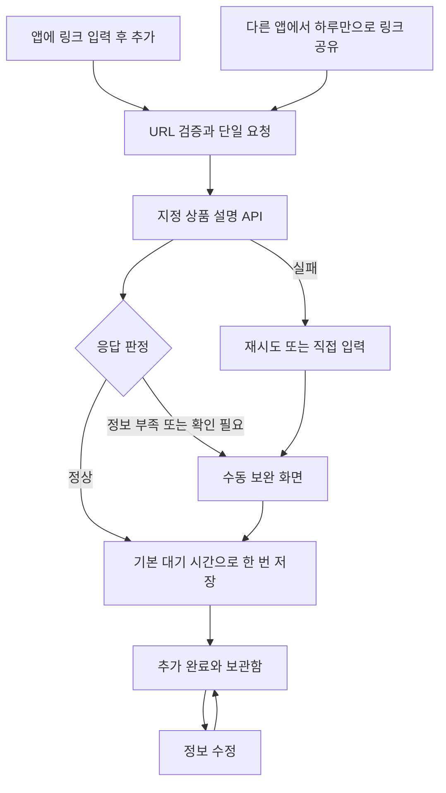

# 하루만 — 링크 API 기반 상품 추가 개발 명세

개정일: 2026-09-29 · 개정: **v3.1**
상태: **구현 재개 — 2026-09-29 12:04:47 KST 시작, 15:04:47 KST 목표 마감.**
후속 입력: **API 계약 초안 수령, 실제 base URL·인증과 캐릭터 디자인 문서 대기**

이 명세는 v2의 스크린샷/이미지 분석 계획을 대체한다. v3.1에서는 제공 이미지 적용, 필요한 이미지 생성, 실기기 반복 검수, 자율 작업·todo·GitHub·release 운영을 추가한다. 사용자는 이번 범위를 **spec·todo 반영**으로 확인했다. 수령한 API 초안은 문서에만 반영하고 추가 계약과 캐릭터 사양은 수령 후 갱신한다. 문서 도착 자체는 앱 구현 재개 지시가 아니다.

## 1. 목표

**재개 지시(2026-09-29 12:04:47 KST):** 사용자가 API 초안·변경 이미지 반영, `md_plus` 주기적 감시와 계획/todo 갱신을 포함해 지금부터 작업을 시작하도록 지시했다. 앞선 문서 전용 제한을 해제하고 아래 180분 구현·실기기 검수·체크포인트·release 절차를 실행한다. 폴더 감지는 15초마다, 작업자의 내용 검토는 단계 전후 및 약 3분 이내 간격으로 수행한다. 추가 MD의 적용 파일·해시·변경점은 [적용 기록](./md_plus/APPLIED.md)에 남긴다.

사용자가 앱에서 상품 링크를 추가하거나 다른 앱의 **공유 → 하루만**으로 링크를 보내면, 지정 API에 링크를 전달한다. 정상 응답으로 상품을 자동 추가하고, 불완전하거나 문제가 있는 응답은 사용자가 수정해 저장한다. 저장한 상품도 나중에 정보 수정이 가능해야 한다.

**스크린샷 선택·이미지 공유·이미지 업로드·이미지 분석 API는 범위에서 제거한다.** API 응답에 포함된 상품 썸네일을 표시하는 것은 유지한다. 기존의 링크 없는 직접 텍스트 입력도 수동 대안으로 유지한다.

| 항목 | v3.1 범위 |
| --- | --- |
| 앱 내 링크 추가 | URL 입력/붙여넣기 → 명시적인 `링크로 추가` → API 요청 |
| Android 링크 공유 | text/plain 공유 대상으로 앱 노출, 종료/실행 중 모두 같은 입력 경로로 수신 |
| 상품 API | 수령 초안의 `POST /v1/products/extract`로 링크 전송. 실제 base URL·인증·서버 동작 미확인 |
| 정상 응답 | 유효성 확인 → 기본 대기 시간 적용 → 상품 한 번 자동 저장 → 추가 완료·수정 진입 |
| 불완전/잘못된 응답 | 얻은 정보를 유지한 수정 draft → 사용자 보완 → 저장 |
| 요청 실패 | 원본 링크 보존, 재시도/직접 입력. 가짜 상품 생성 없음 |
| 수동 수정 | 저장 전 보완, 저장 후 정보 편집. 사용자가 수정한 필드를 지연 응답이 덮어쓰지 않음 |
| 직접 입력 | 링크 없이 상품명·선택 가격·설명·대기 시간을 입력해 저장 |
| 수집 방식 | 앱 내부 HTML/WebView/DOM 파싱은 보류. 상품 정보 수집은 지정 API가 담당 |
| 플랫폼 | 쿠팡 링크 우선. 인스타그램 신규 서비스 보류, 유튜브 제외, 수동 출처 미지정 허용 |
| 디자인 | 빨강 테마, 라이트/다크/시스템 설정, 반응형, 절제된 클릭 반응과 풍성한 일회성 축하 |
| 브랜드 애셋 | 현재 img의 심벌·로고·마스코트 이미지를 화면·런처에 맞게 적용 계획. 원본 보존 |
| 캐릭터 | 상태 슬롯을 먼저 설계, 최종 이름·외형은 추후 MD로 확정. 필요한 임시 보조 그림 생성 허용 |
| 추가 이미지 | 구현 재개 후 테마에 맞는 빈 상태·온보딩·축하 이미지 등을 직접 생성·검수·적용 가능 |
| 문구 | 짧고 친근한 해요체, 실제 상태에 맞춘 `추가했어요`·`확인해 주세요` 등 |
| 개발 운영 | 연결 폰 반복 디버깅, UI·모션·반응형 수정/재검증, todo 즉시 갱신, main 단계별 반영 |
| 배포 | 서명·검증된 release APK를 GitHub Releases와 로컬 버전 폴더에 보존 |

## 2. 문서 구성과 우선순위

| 문서 | 책임 |
| --- | --- |
| [GOAL_SPEC.md](./GOAL_SPEC.md) | 범위·제품 흐름·완료 조건·후속 작업 운영 |
| [todo.md](./todo.md) | 설계 완료와 구현 대기 구분, 단계별 작업/검증 |
| [LINK_API_DESIGN.md](./LINK_API_DESIGN.md) | 링크 공유·API 경계·응답 판정·자동 저장·수정·중복/오류 처리 |
| [UI_CHARACTER_DESIGN.md](./UI_CHARACTER_DESIGN.md) | 화면·문구·테마·반응형·모션·캐릭터 수용 구조 |
| [ASSET_PLAN.md](./ASSET_PLAN.md) | img 실물 점검·화면별 배치·파생본·필요 이미지 생성 범위 |
| [DEVELOPMENT_RUNBOOK.md](./DEVELOPMENT_RUNBOOK.md) | 180분 목표·자율 작업·실시간 todo·실기기 반복 검수·체크포인트 |
| [RELEASE_WORKFLOW.md](./RELEASE_WORKFLOW.md) | 서명·버전·최종 APK 검증·GitHub Releases·로컬 보관 |
| [CHECKPOINT.md](./CHECKPOINT.md) | 실제 코드·기존 APK·검증 증거·재개 환경 |

최신 사용자 지시와 이후 제공되는 명시적인 사양을 우선한다. API/캐릭터 문서를 받으면 이 문서들의 대응 항목과 변경 기록을 함께 갱신한다. 기존 조사·v1/v2 문서 보존물은 실행 목표로 다시 활성화하지 않는다.

## 3. 핵심 사용자 흐름

### 앱 내 링크 추가

- URL 입력/붙여넣기를 제공한다. 클립보드를 배경에서 감시하지 않는다.
- 사용자가 `링크로 추가`를 누르면 검증 후 요청한다. 입력할 때마다 API를 호출하지 않는다.
- API 문서 적용 전에는 미연결 안내와 직접 입력을 제공한다. 요청이 이뤄진 것처럼 로딩하거나 성공값을 만들지 않는다.

### Android 공유 수신

- 다른 앱의 링크 공유 메뉴에서 하루만을 선택하면 앱을 열고 요청 흐름을 시작한다. 공유 후 같은 URL을 다시 복사/붙여넣게 하지 않는다.
- API 연결 이후 정상 단일 링크는 추가 제출 확인 없이 처리한다. URL이 여러 개이면 처리할 링크 하나를 고르게 한다. 지원하지 않는 내용은 설명하고 직접 입력으로 이어간다.
- 앱 최초 실행, 실행 중 새 공유, 회전/프로세스 재생성, 이미 작성 중인 draft가 있는 경우를 구분한다. 기존 draft를 조용히 덮어쓰지 않는다.
- 공유 Intent를 다시 읽는 일이 중복 요청·중복 상품으로 이어지지 않게 한다. 여러 링크의 자동 일괄 추가는 이번 범위가 아니다.

### 자동 추가와 수동 보완

- 정상 판정 기준은 수령한 [API 응답 초안](./HARUMAN_API_RESPONSE_SPEC.md)과 [링크/API 설계](./LINK_API_DESIGN.md)를 따른다. `success`의 이름·가격·대표 이미지 URL 등 계약값을 검증하고, `partial`은 수동 보완으로 보낸다.
- 유효한 응답은 한 번 저장하고 `추가했어요`와 `정보 수정`을 제공한다. 모든 정상 응답에 별도 저장 확인을 강제하지 않는다.
- 기본 대기 시간은 요청 시작 시 현재 설정을 기록해 두고 실제 저장 시점부터 계산한다. draft에서 사용자가 바꾼 시간은 우선한다. 추가 완료/상세 화면에서 적용된 시간을 확인하고 조정할 수 있다.
- 핵심 정보가 비어 있거나 가격/옵션이 애매하면 불완전 draft로 열어 확인한다. 무조건 첫 가격·최솟값·추천 상품을 정답으로 저장하지 않는다.
- 요청 실패 시 원본 링크와 입력을 유지한다. 수동 저장에서 상품명은 필수이고 미확인 가격은 null로 허용한다. 설명·이미지는 없어도 저장할 수 있다.

### 저장 후 수정

- 상세 화면에서 이름·가격·상품 설명/메모를 수정할 수 있다. API 원본 응답과 사용자 확정값은 구분한다.
- 이름·가격뿐 아니라 상품 설명도 직접 입력·수정할 수 있어야 한다. **수령한 API 초안에는 description 필드가 없다.** 현재 API로 자동 설명을 채우는 기능은 계약 확인 대기이며 옵션·가격 조건을 설명으로 대체하지 않는다. 상품 이미지가 잘못되거나 표시되지 않으면 숨기기/기본 그림을 제공한다. 사용자 이미지 업로드는 추가하지 않는다.
- 재조회 기능을 넣더라도 사용자가 고친 필드를 자동으로 덮어쓰지 않는다. 저장된 원본 링크는 읽기 전용으로 보존하고 새 링크는 별도 추가 작업으로 시작한다.
- 과거 결정의 합계는 결정 시점 확정 금액을 기준으로 보존한다. 상품 편집만으로 이미 기록된 포기 금액이 조용히 바뀌지 않게 설계한다. 구버전 기록의 이행 기준도 함께 기록한다.

## 4. API 초안 수령과 구현 경계

### 현재: 수령 초안에 맞춰 앱 구현, 실접속 정보 대기

- 작업 중 추가된 [HARUMAN_API_RESPONSE_SPEC.md](./HARUMAN_API_RESPONSE_SPEC.md)와 [HARUMAN_PRODUCT_API_PLAN.md](./HARUMAN_PRODUCT_API_PLAN.md)를 계약 초안 입력으로 읽었다. 서버 구현·실제 응답 검증 증거는 아니다.
- 문서상 요청은 `POST /v1/products/extract`, body는 `url`이다. 응답의 `status=success/partial/error`, 상품명·원 단위 가격·이미지·옵션·가격 조건을 adapter에 매핑한다. 구체 계약은 LINK_API_DESIGN에서 관리한다.
- 실제 base URL·인증값·인증 실패 계약·취소·멱등성·실측 시간은 미확정이다. 서버 55초/사용자 대기 1분은 목표이며 보장 수치가 아니다. 상품 설명 필드는 제공되지 않았다.
- Mac 서버 계획의 다른 쇼핑몰 지원은 Android 쿠팡 범위 확장의 근거로 삼지 않는다. 이 작업에서 서버·브라우저 수집·모델 설정을 시작하지 않는다.
- 임의 API 주소·API 키를 만들어 넣지 않는다. 링크나 상품 페이지를 실제 호출하지 않는다.
- `ProductLinkService`의 미연결 상태와 실제 HTTPS adapter를 구현하고, 접속 정보가 없으면 NotConfigured로 안내한다. 스크린샷용 인터페이스는 새 설계에서 사용하지 않는다.

### 구현 재개 전 추가 확인

- 계약 변경·실제 base URL·인증·정상/부분/오류 응답을 확인해 내부 모델 매핑을 마무리한다. 상품 설명 자동 수신은 별도 필드 계약이 제공되기 전까지 미지원으로 둔다.
- 인증 위치, 정상/부분/오류 샘플, timeout·재시도·rate limit·취소·중복 요청 정책을 사양에 맞춰 정한다.
- 링크 추가/공유 후 API 전송과 응답 기반 자동 추가는 **실제 구현 재개 후** 검증한다. 문서 수령이나 테스트 Fake 성공을 실연동 완료로 세지 않는다.

## 5. 데이터·상태 설계 원칙

- 입력 방식은 `LINK_INPUT / LINK_SHARE / MANUAL`, 출처는 별도 필드로 관리한다. 과거 방식은 확인할 수 없으면 legacy/unknown으로 유지한다.
- 원본 URL을 보존한다. 쿠팡 단축 링크를 앱이 직접 열어 확장하거나 상품 HTML을 파싱하지 않고, API 사양에 맞춰 그대로 전달한다.
- 공유 텍스트에서 URL만 분리한다. 링크 주변 문장·클립보드 전체·계정 정보는 요청에 포함하지 않는다.
- 동일 요청의 재전달과 사용자가 새로 시도한 요청을 구분한다. 자동 저장은 요청별 한 번, 기존 보류 상품의 중복은 안내한다.
- 여러 요청이 엇갈려 끝나도 상품/화면에 올바른 결과만 반영한다. 취소·화면 이탈·URL 교체·수동 저장 후 이전 응답은 자동 추가를 만들지 않는다.
- 통신 상태와 저장 상태를 나눈다. API 성공 뒤 로컬 저장이 실패하면 `추가 완료`를 표시하지 않는다.
- 기존 SharedPreferences JSON에 호환 가능한 필드를 추가한다. 기존 인스타그램 enum/항목을 제거해 기록을 잃게 하지 않는다.
- 금액 미상은 null이다. 명시적인 0원과 구분하고, 불명 금액/샘플 데이터로 절약 실적을 생성하지 않는다.

## 6. 테마·반응형·모션

[UI_CHARACTER_DESIGN.md](./UI_CHARACTER_DESIGN.md)에 색상 토큰과 화면별 상태를 모은다. 기존에 합의한 사항을 유지한다.

여백·타이포·정보 위계는 [TDS Mobile](https://tossmini-docs.toss.im/tds-mobile/)과 [제공 React 디자인](./Personal%20Consumption%20Decision%20App/src/App.tsx)을 참고한다. 이후 캐릭터 디자인 문서가 오면 구체적인 배치와 자산을 통합한다.

- 브랜드의 빨강·화이트·웜톤을 따른다. `img/`의 현재 심벌·로고·마스코트를 기준으로 하고, 작업 도중 교체된 이전 애셋의 분석을 최신 파일에 적용하지 않는다. 최종 캐릭터의 상태별 규격은 디자인 MD로 확정한다.
- 안내 문구는 `추가했어요`, `저장했어요`, `확인해 주세요`처럼 친근한 해요체를 쓴다. 버튼은 행동을 짧게 표시하고, 저장 전 성공·실제 주문 완료·확인되지 않은 절약을 말하지 않는다.
- 설정은 `라이트 / 다크 / 시스템 설정 따르기`, 기본 SYSTEM. 즉시 적용·재실행 보존·시스템 변경 반영·입력/요청 상태 보존을 검증한다.
- 시스템 모드는 밝기를 따르며, 배경화면의 동적 색상으로 브랜드 빨강을 바꾸지 않는다.
- 320/360/412dp, 600/840dp, 가로 화면, 글꼴 1.0/1.3/2.0, IME와 시스템 inset을 고려한다. 주요 터치 영역 48dp, 라벨/선택 상태/오류 접근성을 제공한다.
- 클릭 80–140ms, 화면/탭 전환 180–240ms, 저장 행 220–300ms를 초기값으로 삼는다.
- 포기·절약 마일스톤의 축하는 1200–1600ms 한 번, 금액 카운트는 400–650ms. 일상 저장/요청 성공은 짧게 반응한다.
- 모션 감소/배율 0에서는 정적 결과를 보여준다. 효과가 저장·합산·CTA를 막거나 화면 재생성 때 반복되지 않게 한다.

## 7. 캐릭터 디자인 문서를 받을 준비

캐릭터가 들어갈 위치와 의미만 정의한다. 온보딩/빈 보관함/불러오는 중/추가 완료/수정 필요/오류/축하 상태에 각각 적절한 슬롯을 두되, 캐릭터 없이도 모든 정보를 이해하고 조작할 수 있어야 한다.

캐릭터 이름·외형·성격·표정·포즈·정확한 배치·자산 형식은 사용자가 보낼 디자인 문서로 확정한다. 중립적인 아이콘/도형과 문구를 대체 표시로 설계하고, 개발 중 필요하면 브랜드에 맞는 임시 보조 그림을 생성해 적용할 수 있다. 로딩 캐릭터가 실제 요청 없이 분석을 수행하는 것처럼 보이지 않게 한다.

디자인 문서를 받으면 색상 충돌, 라이트/다크 자산, 정적/모션 감소 이미지, 터치/가독성 방해 여부, 상태별 문구·표정 매핑, 자산 경로/크기/renderer를 검토해 설계에 반영한다. 없는 캐릭터 자산을 완성됐다고 표시하지 않는다.

## 8. 현재 코드·수정 예정 위치

제공 애셋 계획은 [ASSET_PLAN](./ASSET_PLAN.md)을 따른다. 현재 원본을 보존하고 런처/시작 화면의 심벌, 온보딩/앱 정보의 로고, 상단 워드마크를 먼저 적용한다. 여백·알파 경계·단색 변형의 디테일과 작은 크기를 검수한다. 파일별 해시로 중복을 확인해 런타임 중복 포함을 피한다.

필요한 래스터 보조 이미지는 imagegen 절차로 생성·검수·적용한다. 단순 기능 아이콘·효과는 벡터/Compose를 우선한다. 생성 프롬프트·버전·해시·사용 위치를 기록하고 연결 폰에서 확인한다. 임시 그림을 최종 캐릭터나 실제 상품 사진으로 표시하지 않는다.

현재 앱의 수동 등록·보관·결정·기록·MY 및 텍스트 공유 골격은 유지되어 있다. 새 링크 API 자동 추가, 응답 수정/편집, 빨강/다크 테마와 캐릭터 구조는 구현되지 않았다. 중지 전 JVM 9개/Android 6개 테스트는 기존 코드의 일부 동작만 검증했다.

| 위치 | 구현 재개 후 역할 |
| --- | --- |
| `MainActivity.kt` | ACTION_SEND 텍스트 공유, cold/warm 진입, 소비된 Intent 재처리 방지 |
| `ui/HarumanApp.kt` | 링크 입력/요청/자동 저장/추가 완료/편집 연결 |
| `ui/AddSheet.kt` | 링크 입력, API 결과 보완, 독립 직접 입력 |
| `data/LocalStore.kt` | 확정 필드·출처·요청 식별·결정 금액·설정의 호환 저장 |
| 신규 `data/` API 경계 | 링크 서비스, 응답 정규화, 유효성, 오류와 취소 |
| `ui/Screens.kt`, `ui/DecisionScreens.kt` | 상세 편집, 설정, 반응형, 결과·캐릭터 상태 |
| `ui/theme/`, `ui/Components.kt` | 테마 토큰, 공통 모션, 캐릭터 대체 표시 |

현재 Gradle/JBR 환경은 체크포인트를 유지한다. HTTP/이미지 표시 라이브러리 버전은 사양과 현재 Kotlin/minSdk 호환을 확인한 뒤 도입한다. Room·새 백엔드를 동시에 필수로 도입하지 않는다.

## 9. 구현 재개 후 약 180분 계획

| 구간 | 분 | 목표 |
| --- | ---: | --- |
| 0–20분 | 20 | 최신 MD·계약·저장 호환, 폰 연결·서명/버전 조건·목표/마감 확인 |
| 20–60분 | 40 | 링크 직접 입력·Android 공유·서비스 adapter·요청 수명 |
| 60–100분 | 40 | 응답 정규화·자동 추가·보완/저장 후 수정·수동 대안 |
| 100–150분 | 50 | 3가지 테마·반응형·제공/필요 생성 자산·모션·해요체·결함 수정 |
| 150–180분 | 30 | 최종 QA·서명 release·로컬 버전 보존·GitHub Release·체크포인트 |
| 합계 | **180** | |

**타이머는 12:04:47 KST에 시작했다.** API 문서가 없으면 향후 구현에서도 미연결 구조와 독립 가능한 흐름부터 진행하고 실제 자동 추가는 보류로 남긴다. 캐릭터 MD가 없으면 중립 표시 또는 검수한 임시 보조 이미지를 사용하며 최종 캐릭터 완료라고 하지 않는다. 각 구간에서 실기기 검수를 반복하고 마지막 30분은 최종 검증·배포·인계에 확보한다.

재개 후에는 사용자가 중간에 개입하지 않아도 작업자가 목표를 정하고 완료 조건을 충족할 때까지 구현·검수·수정을 이어간다. 첫 빌드 성공으로 조기 종료하지 않고 남은 시간에 UI·반응형·모션·데이터·배포 품질을 개선한다. 의미 없는 대기나 같은 검사 반복으로 시간을 채우지 않는다. 180분 마감에도 필수 항목이 남으면 실제 상태와 후속 작업을 기록하며 완료로 포장하지 않는다. 세부 운영은 [DEVELOPMENT_RUNBOOK](./DEVELOPMENT_RUNBOOK.md)을 따른다.

## 10. 완료 구분

### 초기 설계 작업 완료 기준

v3.1 spec/todo/링크 API/UI·캐릭터/애셋/개발 운영/배포 설계가 일치한다. 스크린샷 입력 제거, API/캐릭터 미정 사항, 이미지 생성 허용 범위, 폰 검수·실시간 todo·GitHub·release 규칙이 명확하고 `releases/` 보관 폴더가 준비되어 있다. 앱 코드·빌드·기기는 변경하지 않는다.

### 후속 앱 기능 완료

링크 직접 입력과 실제 공유 양쪽에서 지정 API 호출 → 정상 응답 자동 저장 → 상세/기록/재실행을 관찰한다. 불완전 응답 보완, 실패/재시도/직접 입력, 저장 후 정보 수정, 중복·취소·지연 응답 보호, 기존 기록, 테마/모션을 검증한다.

실제 API가 연결되지 않은 상태는 **준비 구조 완료 / 링크 API 기능 미완료**로 구분한다. 캐릭터 슬롯과 실제 캐릭터 자산 적용도 구분한다. 스크린샷이나 기기 사진을 QA 증거로 촬영하는 것은 사용자 상품 입력 기능과 별개다.

## 11. 작업 운영과 인계

품질·배포 완료에는 연결 폰의 UI 정렬·반응형·모션 검수와 결함 재검증을 포함한다. 모션은 녹화, 정렬은 화면으로 근거를 남긴다. 최종 서명 release APK의 package·버전·인증서·SHA256·설치/실행을 확인하고 `releases/<versionName>-<versionCode>/haruman-<versionName>-<versionCode>-release.apk`에 보존한다. GitHub Release asset으로 올린 뒤 다운로드 해시를 대조한다. debug·QA variant와 최종 release의 검증을 구분하고 실제 빌드한 commit에 tag를 연결한다. 세부 조건은 [RELEASE_WORKFLOW](./RELEASE_WORKFLOW.md)를 따른다.

- 사용자의 재개 지시에 따라 앱 구현을 진행한다. md_plus 신규 문서를 검토해 spec·todo·관련 구현을 계속 갱신한다.
- API/캐릭터 MD를 받으면 파일 출처·버전·확정 내용·미해결 항목을 먼저 기록하고 현재 설계와 매핑한다.
- 구현 재개 시 시작·마감과 20/60/100/150/180분의 실제 결과를 기록한다. todo는 작업 시작·완료·실패·결함 발견 즉시 갱신한다. 문서/코드 작성만 끝난 항목을 실기기 검증 완료로 체크하지 않는다.
- 파일 소유 범위를 나눠 병렬로 작업한다. 기기·빌드·통합은 한 담당자가 수행해 서로 설치하거나 화면을 바꾸지 않게 한다.
- 의미 있는 단계마다 테스트/폰 검수 결과와 source를 GitHub main에 commit/push하고 원격 반영을 확인한다. force push를 하지 않는다. 실제 release는 검증한 파일을 버전별로 보존·발행한다.
- 체크포인트의 원본 ZIP/APK/증거와 기존 사용자 데이터를 보존한다. 초기 인스타그램/유튜브·로컬 쿠팡 파서 계획을 자동으로 재활성화하지 않는다.
- 최종 인계는 변경 파일, 계약/자산 적용 상태, 실제 테스트 범위, APK 경로/해시, 남은 제한을 구분한다. 설계·Fake·실기기 검증을 같은 성공으로 집계하지 않는다.
