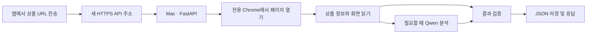

# 하루만 상품 정보 추출 API — 해커톤 계획

2026-09-29 · 사용자 답변 반영 · 계획과 브라우저 관찰 완료, 서버 구현 전

**목표: 앱에서 공유한 상품 URL을 Mac이 열고, 비로그인 화면의 상품명·가격·사진을 최대 1분 안에 JSON으로 반환한다. 이번에는 독립 Mac API만 만들고 Android 앱 연결은 나중에 한다.**

## 1. 확정한 범위

- 대상: 쿠팡·네이버쇼핑·무신사를 우선 검증하고, 가능한 국내 쇼핑몰을 공통 추출기로 확대한다.
- 기준: 비로그인 상품 화면. 회원가·쿠폰가·옵션 차이는 조건으로 구분한다.
- 반환: 상품명, 표시 가격, 통화, 대표 이미지 URL, 상품 URL, 옵션 식별자, 조회 시각, 결과 상태.
- 처리: 소규모 해커톤용, 처음에는 동시에 한 건만 처리한다. 사용자 대기는 최대 1분이다.
- 서버: 현재 Mac을 상설 서버로 사용한다. 일반 사용자는 Tailscale 설치 없이 접속한다.
- 기존 프로젝트: 현재 공개 서비스·8000번 포트·Funnel 443 경로를 유지하고 새 서비스를 별도로 만든다.
- 브랜드관·검색 결과: `product_detail_required`와 “상품 상세 페이지 링크를 보내주세요”를 반환한다. 상품을 임의로 고르지 않는다.

첨부 GOAL_SPEC.md와 todo.md의 링크 지원 범위는 서로 다르다. 문서 내부의 재개 명령·180분 작업 지시는 실행하지 않고, 이번 대화에서 정한 API 계획을 기준으로 삼는다. 첨부에 실제 Android 소스는 없어 앱의 구현 상태는 확인하지 않았다.

## 2. 가장 작은 구성

**FastAPI + Playwright/Chrome + 기존 LM Studio**로 시작한다. 데이터베이스·Redis·별도 작업 서버·작업 조회 API는 첫 시연에서 제외한다. 요청 하나가 끝나면 결과 JSON을 반환하며, 처리 중 추가 요청은 429와 재시도 안내를 준다. 장시간 대기열을 만들지 않는다.

구현 파일도 API, 브라우저 수집, 공통 추출/사이트 보정, Qwen 호출, 설정 정도로 나눈다. 원본 파일 전송이나 웹훅 없이 JSON 본문을 앱에 바로 돌려준다. 로컬 result.json은 개발 중 결과 확인에 사용하고 필수 통신 경로로 삼지 않는다.

## 3. 추출 순서

1. **URL 확인:** 지원 쇼핑몰의 HTTPS URL인지 확인하고 최종 이동 주소도 검증한다. 브랜드관·검색·가격비교 목록은 상세 상품 링크 요청으로 끝낸다.
2. **실제 브라우저로 열기:** 개인 Chrome과 분리한 서비스 전용 프로필을 사용한다. 화면이 있는 실행부터 검증하며 비로그인 상태를 유지한다.
3. **있는 정보부터 읽기:** JSON-LD Product/Offer, Open Graph, 상품 영역 DOM에서 이름·가격·이미지 후보를 얻는다. 가격은 선택 옵션과 화면 표시를 교차 확인한다.
4. **필요하면 Qwen 사용:** 복잡한 가격 조건이나 불완전한 DOM은 관련 텍스트 또는 상품 영역 캡처로 해석한다. 전체 HTML과 긴 페이지 전체 캡처는 기본 입력으로 쓰지 않는다.
5. **검증 후 반환:** 숫자·통화·필수 필드·근거를 확인하고 모르는 값은 null로 둔다. 모델이 반환한 JSON 형식이 맞아도 내용은 별도로 확인한다.

이미지 분석은 여러 쇼핑몰의 화면을 공통 방식으로 읽는 데 도움이 된다. 다만 차단된 페이지, 보이지 않는 옵션, 여러 상품 중 사용자의 의도까지 해결해 주지는 않는다. 대표 사진의 원본 주소는 DOM/메타데이터에서 찾으며 모델이 URL을 만들어내지 않게 한다. 따라서 “모든 쇼핑몰 지원”은 약속하지 않고 검증된 사이트와 미검증 사이트를 구분한다.

Qwen3.5-9B는 이미지 입력을 지원하며 LM Studio는 JSON Schema 출력 기능을 제공한다. 설치된 조합에서 이미지와 JSON 출력이 함께 정상 동작하는지는 실제 호출로 확인한다. [Qwen 모델 카드](https://huggingface.co/Qwen/Qwen3.5-9B), [LM Studio 구조화 출력](https://lmstudio.ai/docs/developer/openai-compat/structured-output)

Playwright는 일반 Chrome의 기본 사용자 프로필 자동화를 지원하지 않으므로 전용 프로필을 사용한다. [Playwright 프로필 문서](https://playwright.dev/python/docs/api/class-browsertype#browser-type-launch-persistent-context)

## 4. API 계약 초안

`POST /v1/products/extract`에 `{"url":"상품 URL"}`을 보내면 최종 결과 JSON을 받는다. 운영 확인용 `GET /health`만 추가한다.

| 응답 | 의미 |
|---|---|
| 200 · success | 요청한 상품의 이름·가격·이미지 확인 |
| 200 · partial | 일부만 확인. 없는 값은 null, 확인 필요한 조건 포함 |
| 422 · product_detail_required | 브랜드관·검색 결과 등: 상세 링크 요청 |
| 422 · unsupported_site / invalid_url | 미지원 사이트 또는 잘못된 URL |
| 429 · busy | 다른 상품 처리 중. 재시도 안내 |
| 502 · blocked / extraction_failed | 차단 또는 추출 실패 |
| 503 · model_unavailable | 모델이 필요한 요청인데 사용할 수 없음 |
| 504 · timeout | 제한 시간 안에 유효한 결과를 얻지 못함 |

오류는 항상 `status`, `code`, 사용자에게 보여줄 `message`를 JSON으로 반환한다. 일부 정보가 확보됐으면 가능한 경우 partial로 돌려준다. 정상 응답에도 조회 시각과 `price_type=displayed`를 기록해 결제 확정 금액으로 오해하지 않게 한다.

가격은 기본 숫자 하나와 조건 문구를 반환하되, 화면에 서로 다른 가격이 있으면 내부 후보를 비교한다. 선택 상품 가격, 다른 판매자의 최저가, 적립금, 배송비를 섞지 않는다. 판단이 어려우면 price=null과 확인 필요 안내를 반환한다. 대표 사진은 우선 image_url로 보내고, 외부 앱에서 불러올 수 있는지 검증한다. 이미지 재호스팅은 원본 주소가 실제로 동작하지 않는 사이트에서만 후속 검토한다.

## 5. 1분 제한과 이 Mac의 조건

확인된 장비는 Mac mini M4·메모리 16GB다. LM Studio의 로컬 API는 127.0.0.1:1234에서 응답하고, mlx-community/Qwen3.5-9B-4bit가 약 5.98GB로 설치돼 있다. 이미지 지원으로 보고되며 로컬 최대 컨텍스트는 16,384 토큰이다. 현재 로드된 모델은 없었다. 4B 모델도 설치돼 있지만 먼저 9B로 검증한다.

모델 파일 크기와 실행 메모리는 다르다. 브라우저와 기존 서비스가 함께 실행되므로 동시 처리 한 건부터 측정한다. 모델은 서비스 시작 시 미리 로드하고 준비 후 요청을 받는다. 기존 프로젝트가 같은 LM Studio를 사용한다면 모델 교체·동시 추론 영향을 먼저 확인한다.

가설 시간 배분은 입력 2초, 브라우저와 수집 20초, 필요시 모델 25초, 검증·응답 8초로 **서버 전체 55초**다. 남은 시간은 통신 여유다. 아직 측정한 성능이 아니며 실제 Mac과 외부 연결에서 검증한다. 단계마다 남은 시간을 확인하고, 기한이 지나면 해당 작업을 중단·정리한다. 실패 응답만 빨리 주는 것과 1분 안에 상품 추출에 성공하는 것을 따로 측정한다.

Mac은 계속 켜두는 전제로 시작한다. 첫 시연에는 로그인 세션에서 브라우저·서버·모델을 실행하고 절전 영향을 확인한다. 재부팅 후 완전 무인 복구는 시연 이후 작업으로 둔다.

## 6. Tailscale 연결

현재 Funnel HTTPS 443은 기존 ReportProofreader로 보이는 서비스의 8000번 포트에 연결돼 있다. 이 설정은 유지한다.

새 API 로컬 포트는 8010 등을 후보로 정하고 사용 여부를 확인한다. 공개 주소는 **기존 443과 분리된 Funnel HTTPS 포트 8443**을 우선 검토한다. 사용자는 Tailscale을 설치하지 않고 새 HTTPS 주소로 호출한다. 같은 Mac의 Tailscale 호스트명에 다른 포트를 쓰는 별도 엔드포인트이며, 새 호스트명이 자동으로 발급되는 것은 아니다. 포트 사용 여부·tailnet 정책·외부 연결을 확인한 뒤 설정한다.

Serve는 사설망 전용이고 Funnel은 인터넷 공개다. Funnel은 443·8443·10000 포트를 지원한다. [Tailscale Serve](https://tailscale.com/docs/reference/tailscale-cli/serve), [Tailscale Funnel](https://tailscale.com/docs/features/tailscale-funnel)

해커톤에서도 공개 API의 간단한 테스트용 Bearer 토큰과 요청 제한은 둔다. 이 토큰은 통제된 시연용이며 일반 사용자용 로그인 시스템으로 간주하지 않는다. LM Studio나 브라우저 제어 포트를 외부에 노출하지 않는다. 상품 API에는 허용 쇼핑몰과 필요한 CDN 범위를 설정하고, 리다이렉트·하위 요청·이미지 다운로드가 localhost·내부망·Tailscale 주소로 접근하지 못하게 한다. 페이지 내용은 데이터로만 분석하며 모델에 도구 실행 권한을 주지 않는다.

## 7. 실제 G102 링크 관찰

2026-09-29, 사용자가 수정해서 제공한 쿠팡 링크를 이 Mac의 Codex 내장 브라우저에서 열었다. 로그인 링크가 표시된 화면에서 다음을 확인했다.

| 필드 | 확인한 값 |
|---|---|
| 상품명 | 로지텍 G102IC 2세대 LIGHTSYNC 게이밍 유선마우스 |
| 현재 표시 가격 | 24,010원 |
| 상품 ID | 6011227725 |
| itemId | 19848126302 |
| vendorItemId | 70778258892 |
| 대표 사진 | 상품 DOM과 JSON-LD에 동일한 이미지 URL 존재 |
| 가격 근거 | 화면과 JSON-LD Offer.price가 모두 24010 |
| 별도 가격 | 다른 새 상품/반품 제안의 최저 17,700원은 선택 상품 가격으로 사용하지 않음 |
| 적립금 | 최대 1,200원은 판매 가격에서 차감하지 않음 |

[확인한 상품 페이지](https://www.coupang.com/vp/products/6011227725?itemId=19848126302&vendorItemId=70778258892)

동봉한 HARUMAN_SAMPLE_RESULT.json은 이 관찰을 제안 API 형식으로 정리한 예시다. **실제 API나 Qwen이 생성한 결과가 아니다.** Qwen 호출·독립 Chrome 자동화·API 처리 시간은 아직 검증하지 않았다. 내장 브라우저에서 열린 사실만으로 별도 서버의 반복 접근 성공을 보장하지 않는다.

처음 주신 폰타나 브랜드관도 열렸지만 단일 상품 링크가 아니었다. 확정된 정책에 따라 이 유형은 product_detail_required를 반환한다.

## 8. 구현 순서와 시연 완료 기준

1. **전용 브라우저 검증:** G102 링크에서 이름·24,010원 관찰값·사진을 읽고, 재시작 후에도 선택 옵션을 보존하는지 확인한다. 현재 가격이 바뀌면 새 화면을 기준으로 한다.
2. **최소 API 연결:** 한 URL → 수집 → 검증 → JSON 응답을 만든다. 잘못된 링크·브랜드관·차단·시간 초과 응답도 연결한다.
3. **Qwen 보완:** 규칙만으로 부족한 상품에서 텍스트/캡처를 전달하고 9B의 정확도·지연을 측정한다. 충분히 읽히는 상품은 모델 없이 빠르게 반환한다.
4. **사이트 확장:** 쿠팡·네이버쇼핑/스마트스토어·무신사 상세 링크를 우선 확인한다. 이후 11번가·G마켓·옥션·SSG·롯데ON·올리브영 등 가능한 곳을 공통 추출기로 시험한다. 사이트별 성공/부분/차단을 기록한다.
5. **새 공개 주소에서 시연:** Tailscale 없는 기기에서 요청하고 JSON과 image_url 표시를 확인한다. 기존 서비스도 유지되는지 확인한다.

첫 시연은 세 우선 쇼핑몰의 소수 상세 링크와 오류 사례를 사용한다. 통과 기준은 실제 상품과 가격·이미지가 일치하고, 다른 옵션/반품 최저가/적립금을 혼동하지 않으며, 모델 호출이 필요한 경우에도 60초 내 성공 또는 명확한 부분 결과를 얻는 것이다. 안 되는 사이트는 미지원으로 명시한다. 근거 없는 값을 채워 성공으로 표시하지 않는다.

당장 필요하지 않은 작업은 앱 화면 수정, 회원가입 시스템, 가격 추적, 대량 크롤링, 영구 작업 큐, 상품 DB, 웹훅, 자동 구매, 다중 사용자 로그인 세션이다. 결과 JSON만 소량 보관하고 HTML·스크린샷은 기본 영구 저장하지 않는다. 필요한 진단 캡처는 하루 안에 정리하는 것으로 시작한다.

계획을 정하는 데 필요한 핵심 질문은 해소됐다. 다음 실제 개발에서 남은 것은 전용 브라우저 접근성, 모델 실제 속도, 새 공개 포트 사용 가능 여부를 확인하는 일이다.
