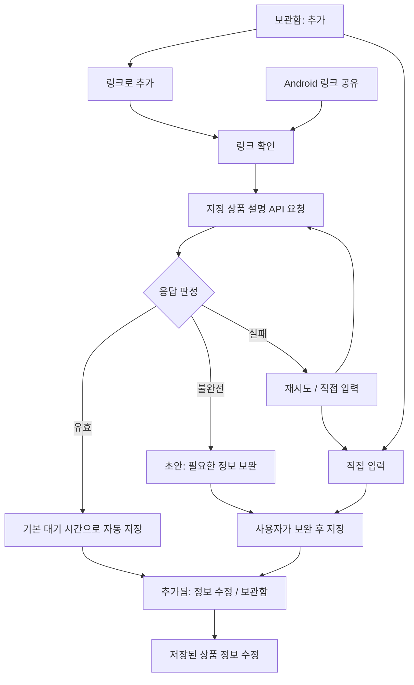

# 하루만 — 링크 기반 추가·수정 화면과 캐릭터 설계

작성일: 2026-09-29 · 적용 명세: v3  
상태: **설계 문서만 작성한다. 앱 구현·빌드·기기 조작은 재개하지 않는다.**

이 문서는 [GOAL_SPEC.md](./GOAL_SPEC.md)의 v3 화면 설계와 캐릭터 연결 경계를 구체화한다. API·요청·저장 판정은 [LINK_API_DESIGN.md](./LINK_API_DESIGN.md), 현재 구현 상태는 [CHECKPOINT.md](./CHECKPOINT.md)를 따른다. 제공될 **상품 설명 API 문서와 캐릭터 디자인 Markdown은 아직 없다.** 외부 API 사양, 캐릭터 이름·외형·자산·렌더러를 확정하지 않는다.

## 1. 이번 화면 방향

기본 입력은 **링크로 추가**와 **직접 입력**이다. 앱 안에서 쿠팡 링크를 입력하거나 Android 텍스트 공유로 받은 링크를 지정 상품 설명 API에 전달한다. 유효한 상품 응답이면 기본 대기 시간을 적용해 자동 저장하고, `추가됐어요` 화면에서 정보 수정으로 이어진다. 저장 전 확인 버튼을 필수로 추가해 자동 추가 흐름을 바꾸지 않는다.

불완전한 응답은 보완할 초안으로 열고, 실패 시 재시도와 직접 입력을 제공한다. 링크 없이 상품명·선택 가격·상품 설명/메모·대기 시간으로 저장하는 기존 직접 입력은 독립적으로 유지한다. 상품명 외 설명·메모·가격은 선택 항목이다.

**스크린샷 선택, 사진 선택기, 이미지 공유 수신, 이미지 분석 API, 사용자 이미지 업로드는 v3 범위에서 완전히 제외한다.** API 응답으로 제공된 상품 썸네일은 표시하며, 정확한 필드와 표시 조건은 향후 API 문서에 따라 매핑한다. 이를 사용자 스크린샷 입력 기능과 혼동하지 않는다. 캐릭터는 앱 상태를 표현하는 장식·안내 역할이며 상품 필드를 추측하거나 수정하지 않는다.

쿠팡만 신규 서비스 출처로 다루고 직접 입력은 출처 미지정을 허용한다. 기존 인스타그램 기록은 읽기 호환을 보존한다. 유튜브 신규 서비스는 제공하지 않는다.

## 2. 화면과 상태 흐름

유효/불완전/실패는 데이터 계층의 판정 결과다. UI는 HTTP 성공 여부나 응답 문자열 길이만 보고 저장 가능 상태를 만들지 않는다. API 문서가 없거나 연결이 설정되지 않았으면 `NotConfigured`에 해당하는 안내와 직접 입력을 보여 주며, 로딩이나 성공을 꾸며 내지 않는다.

| 화면/상태 | 주요 정보·행동 | 캐릭터 슬롯 | 완료 또는 다음 상태 |
|---|---|---|---|
| 온보딩 | 링크로 모아 두고 나중에 판단하는 서비스 설명, 시작하기 | `idle` | 보관함 |
| 보관함 | 저장된 상품·대기/판단 상태, 추가 버튼 | 콘텐츠가 없을 때 `empty` | 입력 선택/상세 |
| 추가 방식 선택 | `링크로 추가`, `직접 입력`을 명확히 구분 | `idle`, 공간 부족 시 생략 | 각 입력 화면 |
| 링크 입력 | 링크 붙여넣기/편집, 쿠팡 출처 안내, `링크로 추가` | `idle` | 요청 중 |
| Android 공유 진입 | 받은 링크 표시와 요청 상태 | `loading` | 자동 추가/보완/실패 |
| 정보 가져오는 중 | 실제 요청 상태, 취소 또는 직접 입력 전환 | `loading` | 결과 판정 |
| 자동 저장 중 | 저장 상태, 중복 추가 방지 | `loading` 또는 중립 진행 표시 | 저장 성공/저장 실패 |
| 추가됨 | 저장된 상품 요약·대기 종료 시각, `정보 수정`, `보관함으로` | `success` | 수정/보관함 |
| 정보 보완 | 확보된 값과 부족한 필드, `보완하고 저장` | `needsReview` | 저장 성공 |
| 가져오기 실패 | 짧은 이유, `다시 시도`, `직접 입력` | `needsReview` | 재요청/수동 초안 |
| 직접 입력 | 이름·선택 가격·대기 시간, `저장하기` | `idle`, 폼 우선 | 추가됨 |
| 저장된 상품 수정 | 현재 저장값과 변경값, `수정 저장`, 취소 | `idle` 또는 생략 | 같은 항목의 상세 |
| 상품 상세 | 상품·출처·대기·결정 상태, 원문 열기·정보 수정 | 기본 생략 | 수정/재판단 |
| 재판단 | 구매 결정·포기·더 생각하기 | `idle` | 결정 결과 |
| 포기 결과/절약 마일스톤 | 실제 결정·확정 금액·기록 | `celebrate` | 보관함/기록 |
| 구매 결정 결과 | 구매하기로 한 상태, 원문 열기 | `success` | 보관함 |
| 소비 기록 | 확정된 선택·합계, 항목 열기 | 기록 없을 때 `empty` | 상세 |
| MY/설정 | 기본 대기 시간·화면 모드·기존 데이터 기능 | 기본 생략 | 즉시 설정 반영 |

캐릭터가 없어도 제목·본문·버튼·상태 표시는 독립적으로 완성되어야 한다. 작은 화면과 키보드 표시 상태에서는 폼과 CTA를 우선하고 캐릭터 영역을 줄이거나 생략한다.

## 3. 링크 입력과 자동 추가

### 앱 안에서 추가

- 보관함 추가 버튼에서 `링크로 추가`를 제공한다.
- URL 필드와 사용자가 누르는 `붙여넣기`, `링크로 추가`를 둔다. 화면을 여는 것만으로 클립보드를 읽어 자동 전송하지 않는다.
- 링크가 비었거나 지원하지 않는 링크면 필드 가까이에 안내하고 요청하지 않는다.
- 지원 링크의 요청 시작은 실제 처리와 연결한다. 중복 탭은 동일 요청을 여러 번 보내거나 동일 항목을 여러 번 저장하지 않는다.
- 기본 대기 시간은 화면에서 확인 가능하게 한다. 요청·저장 시각과 기본 시간 적용 기준은 데이터 설계를 따른다.

### Android 링크 공유

- 전달된 텍스트에서 지원 링크를 인식하고, 실제 API가 연결된 후에는 요청→자동 추가 기본 흐름으로 진행한다.
- 콜드 스타트·실행 중 공유·회전·재생성에서 같은 공유를 중복 저장하지 않는다. UI는 요청 ID와 저장 결과에 결합한다.
- 처리 중 직접 입력으로 전환하거나 취소하면, 늦게 도착한 응답이 닫힌 흐름을 다시 열거나 사용자 수정값을 덮어쓰지 않는다.
- 이미 추가한 상품으로 판정되면 `이미 보관함에 있어요`와 `상품 보기`를 제공한다. 성공 애니메이션을 반복해 신규 추가처럼 보이게 하지 않는다.

### 유효 응답 뒤 자동 저장

유효 응답은 API 문서와 데이터 계층의 검증을 통과한 상품 정보다. 현재 문서에서 외부 필드명이나 가격 필수 여부를 임의로 확정하지 않는다. 가격 미정이 허용되는지는 API·앱 내부 계약에서 정하고 UI에 일관되게 적용한다.

자동 저장이 끝나기 전에는 `추가됐어요`를 표시하지 않는다. 영속화에 실패하면 저장되지 않은 상태로 설명하고 응답 초안을 유지한다. 저장 성공 화면은 실제 저장된 항목 ID를 사용한다.

추가됨 화면의 구성:

1. `success` 슬롯 또는 중립 체크 아이콘.
2. 제목 `보관함에 추가됐어요`.
3. 저장된 상품명·가격 또는 `가격 미정`·쿠팡 출처.
4. `다시 볼 시간`과 실제 적용된 시각/기간.
5. `정보 수정`과 `보관함으로`.

자동 추가는 짧은 성공 피드백만 사용한다. 저장할 때마다 긴 confetti를 재생하지 않는다. 성공 화면 진입, 회전, 테마 변경이 또 다른 저장 동작을 발생시키지 않아야 한다.

## 4. 초안 보완·실패·직접 입력

### 불완전 응답

검증된 응답 필드만 폼에 채운다. 누락·형식 오류·판단할 수 없는 가격 조건은 가까운 필드에 표시한다. 제목은 `조금만 더 적어주세요`, 설명은 `상품 정보를 확인하고 보관함에 넣어주세요`처럼 다음 행동을 알린다. 캐릭터 표정만으로 오류를 전달하지 않는다.

- 필수 정보가 부족하면 아직 저장된 상품으로 집계하지 않는다.
- 사용자가 수정한 이름·가격은 유지한다. 재시도 결과는 초안 수정 정책에 따라 제안하며 조용히 덮어쓰지 않는다.
- 오류 응답에 검증 가능한 일부 상품 필드가 있다면 초안으로 보존할 수 있지만, 오류 메시지의 문장을 상품 설명으로 저장하지 않는다.
- 사용자가 보완하고 저장하면 한 항목만 생성하고 추가됨 화면으로 이동한다.

### 가져오기 실패 또는 API 미설정

| 상태 | 사용자 문구 예시 | 제공 행동 |
|---|---|---|
| 일시적 연결 실패 | `상품 정보를 가져오지 못했어요` | 다시 시도 / 직접 입력 |
| 지원하지 않는 링크 | `쿠팡 상품 링크를 입력해 주세요` | 링크 수정 / 직접 입력 |
| API 설정·문서 미제공 | `링크로 상품을 불러오는 기능은 준비 중이에요` | 직접 입력 / 뒤로가기 |
| 저장 실패 | `아직 보관함에 저장하지 못했어요` | 저장 다시 시도 / 정보 수정 |
| 사용자 취소 | 이전 입력 화면으로 복귀 | 입력 이어서 하기 |

문구는 원인이 실제로 확인된 범위로 제한한다. 무조건 네트워크 문제라고 단정하지 않는다. API 미설정 상태에 성공할 수 없는 무한 재시도 버튼을 두지 않는다. 상태명·서버 응답 원문·인증 정보는 기본 사용자 화면에 노출하지 않는다.

### 직접 입력

링크 없이 바로 폼을 열어 상품명·선택 가격·상품 설명/사용자 메모·대기 시간을 입력한다. 설명과 메모를 비워 두어도 상품명·선택 가격·대기 시간만으로 저장할 수 있다. 출처 미지정을 허용하고 플랫폼 선택이나 API 성공을 요구하지 않는다. 이미지 입력은 없다. 가격을 비워 두면 `null`을 유지하며 0원으로 보이게 하지 않는다.

`시간 없이 저장`은 즉시 판단 가능 동작과 맞는 문구로 정리한다. 사용자가 직접 입력한 값은 저장 전·저장 후 모두 캐릭터에 의해 생성·변경되지 않는다.

## 5. 저장된 상품 정보 수정

`추가됨 → 정보 수정`과 `상품 상세 → 정보 수정`이 같은 수정 폼을 사용한다. 새 상품 추가 폼과 재사용할 수 있지만 **수정은 같은 항목 ID를 유지하는 별도 저장 동작**이다.

| 항목 | 수정 화면 처리 |
|---|---|
| 상품명 | 현재 값을 표시하고 공백 저장 방지 |
| 가격 | 직접 수정 또는 가격 미정으로 변경 가능. 통화·단위와 입력 오류를 명확히 표시 |
| 상품 설명 | API가 제공한 설명을 수정하거나 직접 작성 가능. 빈 값 허용, API 원본 스냅샷은 보존 |
| 사용자 메모 | 구매 이유·고민 등을 직접 작성·수정. 선택 항목이며 API나 캐릭터가 자동 생성·수정하지 않음 |
| 상품 이미지 | API 이미지가 잘못되거나 표시되지 않으면 숨기기/기본 그림으로 전환. 사용자 이미지 선택·공유·업로드 기능은 추가하지 않음 |
| 다시 볼 시간 | 대기 중인 상품의 시각/기간을 확인·수정. 결정 완료 항목을 수정한다고 새 대기를 만들지 않음 |
| 출처/원문 링크 | 현재 출처와 원문을 읽기 전용으로 표시·보존. 다른 링크 조회는 `링크로 추가`에서 별도 작업으로 시작 |
| API가 제공한 부가 정보 | 문서 수령 후 표현 범위 결정. 사용자 수정 필드와 API 출처를 데이터에서 구분 |
| 결정 상태 | 이름·가격 수정으로 구매 결정/포기를 임의 변경하거나 취소하지 않음 |

CTA는 `수정 저장`이며 성공하면 변경된 상세 또는 기존 진입 화면으로 돌아간다. 취소는 저장된 값에 영향을 주지 않는다. 테마 변경·회전·키보드 표시가 수정 초안을 잃게 하지 않는다.

상품 상세의 현재 가격은 편집할 수 있지만, **과거 결정 당시의 가격 스냅샷은 변경하지 않는다.** 소비 기록과 포기 합계는 해당 결정 스냅샷을 계속 사용한다. 이 수정 폼에 별도의 이력 수정 기능을 추가하지 않는다. 상품 가격 편집으로 재판단·confetti·마일스톤 이벤트가 다시 발생하거나 과거 합계가 소급 변경되지 않아야 한다. 구버전 기록의 스냅샷 이행과 계산 규칙은 데이터 설계를 따른다.

## 6. 캐릭터 역할과 상태 계약

캐릭터 디자인 문서가 오기 전에는 아래 **의미 상태만 예약**한다. 이름, 종/인물/물체, 얼굴·표정, 성별, 의상, 고유 색 배치, 말투 설정, 이미지 파일을 임의로 확정하지 않는다.

| 상태 ID | 역할 | 동작/표현 제약 | 자산 없을 때 fallback |
|---|---|---|---|
| `idle` | 시작·입력·숙고를 편안하게 안내 | 콘텐츠보다 작게, 반복 관심 유도 없음 | 중립 링크/보관함 선 아이콘 또는 영역 생략 |
| `loading` | 실제 상품 정보 요청·저장 처리 표시 | 실제 처리 중에만 표시, 진행률을 모르면 숫자 생성 금지 | 중립 진행 표시 + 처리 문구 |
| `success` | 저장 완료·구매 결정 기록 완료 확인 | 실제 성공 이후 짧게, 주문 완료 표현 금지 | 체크 아이콘 |
| `needsReview` | 누락 정보·실패 뒤 보완 행동 안내 | 사용자를 탓하거나 불안하게 하지 않음, 값 추측 없음 | 정보/수정 선 아이콘 |
| `empty` | 빈 보관함·기록의 다음 행동 안내 | 죄책감·구매 압박을 주지 않음 | 보관함 선 아이콘 |
| `celebrate` | 구매 포기·절약 마일스톤 인정 | 실제 이벤트당 1회, 숫자·결정을 바꾸지 않음 | 체크/정적 배지, 허용 시 별도 confetti |

한 화면에 모든 상태 자산을 노출하지 않는다. 현재 데이터 상태에 맞는 슬롯 하나를 사용하며, 오류·로딩·완료를 동시에 표현하지 않는다. `success`와 `celebrate`는 다르다. 일반 자동 추가 성공은 `success`, 실제 포기/마일스톤은 `celebrate`다.

API의 `Failed`/`Interrupted`와 정보 보완 상태는 화면 문구·행동으로 구분하되, 캐릭터는 같은 `needsReview` 슬롯에 매핑한다. 별도의 일곱 번째 `error` 캐릭터 상태를 만들지 않는다.

캐릭터 영역은 장식으로 제공하되 필요한 상태는 읽을 수 있는 텍스트로 함께 표현한다. 장식 자산의 접근성 설명은 중복 낭독을 피하고, 의미 있는 버튼으로 쓰일 경우에만 별도 역할을 부여한다. 캐릭터 터치가 숨겨진 상품 수정이나 분석 요청을 시작하지 않는다.

## 7. 자산 계약 — 디자인 문서 수령 전 미정

현재 확정한 캐릭터 파일은 없다. 아래 표는 수령할 자산에 필요한 정보이며 특정 형식이나 라이브러리를 미리 채택하는 지시가 아니다.

| 계약 항목 | 문서 수령 후 확인할 내용 | 현재 상태 |
|---|---|---|
| 의미 키 | 여섯 상태 ID와 대응 장면·표정·행동 | 상태 슬롯만 정의 |
| 자산 식별 | 파일명/버전/해시/소유·사용 범위/원본 위치 | 미정 |
| 크기·안전 영역 | 기준 크기, 종횡비, 투명 여백, 잘림 허용 범위 | 미정 |
| 테마 | 공용 자산 또는 라이트/다크 변형, 배경 의존성 | 미정 |
| 정적 fallback | 자산 로드 실패·미지원 기기용 한 프레임 또는 중립 아이콘 | 중립 아이콘 사용 가능 |
| reduced motion | 정적 프레임, 생략 가능한 효과, 완료 프레임 | 미정 |
| 시간·반복 | 재생 길이, 루프 가능 상태, 종료 동작 | 이 문서의 모션 제약 안에서 결정 |
| 렌더러 | 파일 형식에 맞는 Android/Compose 표현 수단 | 미정 |
| 성능 | 파일/메모리 예산, 낮은 성능 기기의 대체 경로 | 실자산 수령 후 측정 |

| 수령 형식 | 렌더러 검토 방향 | 적용 전 조건 |
|---|---|---|
| SVG/벡터 원본 | 지원 경로를 확인한 VectorDrawable 또는 Compose 벡터 | 필터·마스크·그라디언트 변환 결과를 직접 확인 |
| PNG/WebP 등 정적 래스터 | 로컬 이미지 렌더러, 해상도에 맞춘 로딩 | 투명 배경·밀도·종횡비·라이트/다크 가독성 확인 |
| Lottie JSON | 해당 형식의 Compose 호환 렌더러 검토 | 실제 자산 호환·의존성·정적 fallback·모션 감소 확인 |
| Rive 등 상태 기반 자산 | 해당 런타임의 Android 지원과 상태 입력 검토 | 필요한 상태만 연결, 라이브러리·크기·성능·fallback 확인 |
| GIF/애니메이션 WebP 등 | 재생 제어 가능한 로컬 디코더 검토 | 무한 재생 금지, 수명주기 정지, 정적 대체 가능 여부 |

지원하지 않는 형식이면 캐릭터를 억지로 재현하거나 다른 외형을 생성하지 않는다. 중립 아이콘을 유지하고 변환 또는 적합한 파일 제공이 필요함을 인계한다. 텍스트·상품 가격·버튼을 자산에 구워 넣지 않고 앱 UI로 표시한다.

## 8. 빨강·화이트 라이트/다크 테마

현재 합의한 색 토큰을 유지한다. 아래 라이트 `Surface`는 흰색이고, 옅은 웜톤은 `BrandSoft`다. 캐릭터 자산의 고유 색상은 디자인 문서 수령 후 확인하며 이 표로 외형을 결정하지 않는다.

| 토큰 | 라이트 | 다크 | 용도 |
|---|---|---|---|
| BrandPrimary / OnBrandPrimary | `#E60012` / `#FFFFFF` | 동일 | 주요 버튼 |
| BrandPressed | `#B80010` | `#B80010` | 눌림 상태 |
| BrandSoft | `#FFF4F3` | `#341B20` | 선택·브랜드 배경 |
| BrandText | `#B80010` | `#FF6B73` | 작은 강조 글자 |
| CelebrationAccent | `#FF303B` | `#FF6B73` | 장식·파티클 |
| Background | `#FAF9F9` | `#121214` | 화면 배경 |
| Surface | `#FFFFFF` | `#1B1B1F` | 카드·시트 |
| TextPrimary | `#202124` | `#F5F5F7` | 제목·본문 |
| TextSecondary | `#5F6368` | `#C6C6CC` | 보조 설명 |
| Border | `#E7E2E2` | `#39393F` | 경계 |

설정은 `SYSTEM / LIGHT / DARK`를 저장하며 기본값은 `SYSTEM`이다. 선택 즉시 전체 앱·다이얼로그·시트·시스템 바에 반영하고 재실행 후에도 유지한다. `SYSTEM`은 밝기만 따르고 배경화면 동적 색상으로 브랜드 빨강을 바꾸지 않는다.

테마 변경은 링크 입력, 요청 연결 상태, 보완 초안, 저장된 상품 수정 초안, 스크롤을 보존한다. 새 API 요청·상품 저장·축하를 재실행하지 않는다. 입력 오류·disabled/pressed·선택·로딩·작은 빨강 문구의 대비와 상태바/내비게이션 바·키보드 주변의 가독성을 두 모드에서 확인한다.

## 9. 반응형과 모션

### 레이아웃

- 320/360/412 dp에서 세로 입력과 스크롤 본문을 기본으로 한다. 캐릭터 슬롯이 필수 입력과 CTA를 밀어내지 않게 한다.
- 600/840 dp에서는 최대 본문 폭과 중앙 정렬을 적용한다. 폭이 충분한 상세·수정 화면만 상품 요약/폼의 2열을 검토한다.
- 가로 화면·IME 표시·fontScale 1.0/1.3/2.0에서 링크 필드·오류 안내·저장/수정 CTA에 접근할 수 있어야 한다.
- 캐릭터는 고정 큰 높이를 강제하지 않는다. 제한된 높이에서는 정적 소형 아이콘 또는 슬롯 생략으로 전환한다.
- 주요 터치 영역은 48 dp 이상이다. 상태 텍스트·버튼 라벨·선택 상태를 접근성 정보로 제공한다.

### 모션

| 상황 | 표현 | 시간·제약 |
|---|---|---|
| 버튼 누름 | ripple/짧은 톤 변화, 필요한 경우 작은 축소 | 80–140 ms |
| 화면·시트·탭 상태 전환 | 짧은 이동/fade/색 전환 | 180–240 ms |
| 자동 추가 성공 | 체크/짧은 캐릭터 성공 반응 | 짧은 한 번, 즉시 다음 행동 가능 |
| 실제 API 요청 중 | 처리 중 표시 | 실제 요청 수명 동안만, 무한 재시도와 연결하지 않음 |
| 포기·절약 마일스톤 | `celebrate` + 허용된 confetti | 1,200–1,600 ms, 이벤트당 한 번 |
| 저장된 상품 수정 | 짧은 저장 완료 피드백 | 축하·마일스톤 재발생 없음 |

캐릭터 원본의 재생 길이와 루프는 미정이며 위 경험 제약에 맞는 변형/정적 프레임을 디자인 문서 수령 후 선택한다. 축하와 캐릭터가 동시에 전체 화면을 가리거나 CTA를 막지 않게 한다. 포기와 마일스톤이 같은 이벤트에서 발생하면 한 번으로 합친다.

reduced motion 또는 시스템 애니메이션 배율 0에서는 이동·파티클을 생략하고 정적 아이콘·완료 문구를 즉시 표시한다. 사용자 정의 Canvas와 외부 자산 렌더러에도 같은 정책을 적용한다. 저장·결정·합계 계산은 애니메이션 완료 콜백에 의존하지 않는다.

## 10. 캐릭터 디자인 Markdown 수령 후 병합 체크리스트

- [ ] 문서의 캐릭터 이름·외형·말투·자산·허용 범위를 확인하고 미정 항목을 갱신한다.
- [ ] `idle/loading/success/needsReview/empty/celebrate`와 실제 제공 장면을 대응한다. 없는 상태는 중립 fallback으로 유지한다.
- [ ] 장면별 문구가 실제 앱 상태와 맞는지 확인한다. 캐릭터가 상품 정보나 구매 결과를 알고 있다고 꾸미지 않는다.
- [ ] 자산 형식별 렌더러·지원 버전·의존성·파일 크기·메모리 영향을 검토한다.
- [ ] 라이트/다크 배경, 투명 여백, 크기/잘림, 정적 fallback을 확인한다.
- [ ] reduced motion 변형과 이벤트당 1회 재생·중단·화면 이탈 정책을 확인한다.
- [ ] 작은 화면·큰 글꼴·키보드 상태에서 캐릭터보다 입력/CTA가 우선되는지 확인한다.
- [ ] 로딩은 실제 API 요청에만, 성공은 실제 저장 성공에만 연결한다.
- [ ] 입력/수정 필드가 캐릭터 상태·자산 로딩·모션에 의해 변경되지 않음을 확인한다.
- [ ] 회전·테마 전환·재진입에서 저장/요청/축하가 반복되지 않는다.
- [ ] 제공된 원본 자산과 변환 결과를 구분하고 실제 채택한 자산/렌더러만 문서에 확정한다.

## 11. 후속 구현에서 남길 증거

현재 아래 항목은 설계이며 구현·시각 검증 결과가 아니다.

| 확인 항목 | 필요한 관찰 | 현재 상태 |
|---|---|---|
| 링크 입력/Android 공유 | 실제 요청 또는 미설정 안내, 중복 처리 방지 | 미구현/미검증 |
| 유효 응답 | 기본 시간 적용, 한 번의 자동 저장, 추가됨 화면 | API 문서 미제공 |
| 불완전/실패 | 보완 초안, 재시도/직접 입력, 값 보존 | 설계만 |
| 직접 입력 | 링크·이미지·API 없이 저장부터 기록까지 | 기존 기본 흐름 존재, v3 재검증 필요 |
| 저장된 상품 수정 | 같은 ID 유지, 설명/메모·이미지 숨기기, 결정 가격 스냅샷 보존, 축하 중복 없음 | 설계만 |
| 캐릭터 | 상태별 자산·정적 fallback·테마·모션 감소 | 디자인 문서/자산 미제공 |
| 테마·반응형 | 세 모드 보존, 폭/글꼴/IME별 실제 화면 | 신규 범위 미검증 |

API 문서나 캐릭터 문서가 없으면 무엇을 연결하지 못했는지 분리해 기록한다. 중립 아이콘이 표시된 화면을 최종 캐릭터 디자인 완료라고 보고하지 않는다. 앱 구현을 재개하라는 지시 전에는 이 설계를 이유로 코드·자산·의존성·기기를 변경하지 않는다.
